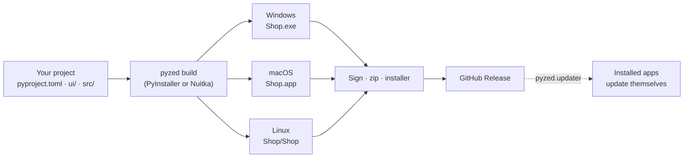

import { Aside, Tabs, TabItem } from '@astrojs/starlight/components';
import NavCards from '../../../components/NavCards.astro';

When your app works on your machine, `pyzed build` (or **File → Export app…** in
[Pyzed Design](/pyzed/editor/exporting/)) packages it with PyInstaller or Nuitka: Python, Pyzed, your dependencies, your code and
your forms go into one folder (or one file) that runs on its own. The people who use it do not need Python, pip or
anything else. Run it from the root of your [project](/pyzed/getting-started/new-project/):

<Tabs syncKey="pkg">
	<TabItem label="uv">
		```bash title="Windows, macOS and Linux"
		uv run pyzed build
		```
	</TabItem>
	<TabItem label="pip">
		```bash title="macOS and Linux"
		source .venv/bin/activate
		pyzed build          # or: python -m pyzed build
		```

		```powershell title="Windows (PowerShell)"
		.venv\Scripts\Activate.ps1
		pyzed build          # or: py -m pyzed build
		```
	</TabItem>
</Tabs>

| You build on | You get | People run it by |
| --- | --- | --- |
| Windows | `dist\Shop\Shop.exe` | Double-clicking it, from a zip or an installer |
| macOS | `dist/Shop.app` | Opening it (sign and notarize it to share it) |
| Linux | `dist/Shop/Shop` | `./Shop`, or from the application menu |

## From your project to your users



<Aside type="caution" title="One build per platform">
A build only runs on the system it was made on: build the Windows app on Windows, the macOS app on macOS and the
Linux app on Linux. A [CI workflow](/pyzed/packaging/ci/) can do all three for you.
</Aside>

## In this section

<NavCards
	items={[
		{ title: 'How building works', text: 'What gets bundled, every option in <code>pyproject.toml</code>, PyInstaller or Nuitka, data files and the splash screen.', href: '/pyzed/packaging/build/', icon: 'rocket', tag: 'Start here' },
		{ title: 'Export from the designer', text: 'File → Export app… in Pyzed Design: platforms, backend, icon and splash screen in one dialog.', href: '/pyzed/editor/exporting/', icon: 'pencil' },
		{ title: 'Windows', text: 'The .exe, folder or single file, a zip or an Inno Setup installer, and signing for SmartScreen.', href: '/pyzed/packaging/windows/', icon: 'seti:windows' },
		{ title: 'macOS', text: 'The .app bundle, bundle identifier, signing, notarization and a .dmg.', href: '/pyzed/packaging/macos/', icon: 'apple' },
		{ title: 'Linux', text: 'Which distribution to build on, archives, menu entries, and AppImage or .deb.', href: '/pyzed/packaging/linux/', icon: 'linux' },
		{ title: 'Icons and metadata', text: 'Name, version, publisher, the icons made from one PNG and the macOS bundle identifier.', href: '/pyzed/packaging/icons-metadata/', icon: 'star' },
		{ title: 'CI with GitHub Actions', text: 'Build all three systems on every tag, publish a release and sign with secrets.', href: '/pyzed/packaging/ci/', icon: 'github' },
		{ title: 'Self-updating apps', text: 'Check GitHub Releases, download with a checksum and swap the app on restart.', href: '/pyzed/packaging/updates/', icon: 'random' },
		{ title: 'Troubleshooting', text: 'Missing modules, blank windows, blocked apps, glibc errors and update messages.', href: '/pyzed/packaging/troubleshooting/', icon: 'warning' },
		{ title: 'CLI reference', text: 'Every option of <code>pyzed build</code> and the other commands.', href: '/pyzed/reference/cli/', icon: 'list-format' },
	]}
/>

## What is supported today

| | Windows | macOS | Linux |
| --- | --- | --- | --- |
| App folder (`pyzed build`) | ✅ `.exe` | ✅ `.app` | ✅ executable |
| Single file (`--onefile`) | ✅ | ✅ | ✅ |
| PyInstaller or Nuitka (`--backend`) | ✅ | ✅ | ✅ |
| x64 and ARM | ✅ | ✅ | ✅ |
| Icon from one PNG (`icon =`) | ✅ `.ico` + window | ✅ `.icns` | ✅ window; menu through a `.desktop` file |
| File details (version, publisher...) | ✅ | ✅ `Info.plist` | - |
| Splash screen | ✅ | ✅ | ✅ |
| CI workflow (`--workflow`) and release archives | ✅ | ✅ | ✅ |
| Self-update (`pyzed.updater`) | ✅ | ✅ | ✅ |
| Signing | With `signtool` | With `codesign` + notarization | Not needed |
| Installer | Your own (Inno Setup, WiX) | Your own `.dmg` (`hdiutil`) | Your own (archive, script, AppImage...) |
| Cross-compiling | ❌ | ❌ | ❌ |

<Aside type="note" title="Status of this section">
Packaging for desktop is ready to use today. Installers, signing and update channels are documented with the tools
that Pyzed Design itself uses, but `pyzed build` does not run them for you yet. Mobile and web targets are planned for
the future and are not available yet.
</Aside>
