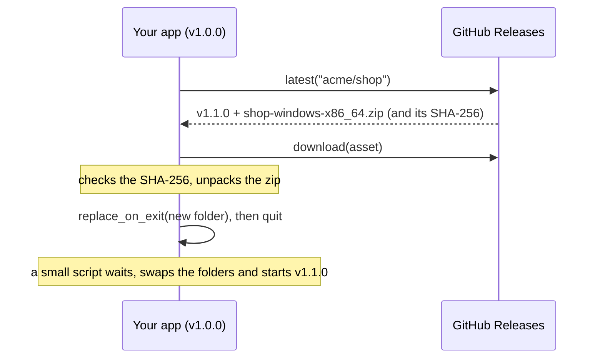

import { Aside, Steps } from '@astrojs/starlight/components';

`pyzed.updater` lets an app built with `pyzed build` update itself from the **GitHub Releases** of its repository: it
finds the newest release, downloads the build for this system, checks it, and swaps the app folder for the new one
when the app restarts. Pyzed Design updates itself with the same module.



## What a release must contain

<Steps>

1. **A version tag** such as `v1.1.0` (pre-releases: `v1.2.0-rc.1`, `v1.2.0-beta.2`...).

2. **One zip per system**, named `<app>-<system>-<arch>.zip`:

   | System | Example |
   | --- | --- |
   | Windows | `shop-windows-x86_64.zip` |
   | macOS | `shop-macos-arm64.zip`, `shop-macos-x86_64.zip` |
   | Linux | `shop-linux-x86_64.zip`, `shop-linux-aarch64.zip` |

   `updater.asset_name("shop")` returns the name for the machine it runs on.

3. **Inside each zip, exactly one entry**: the app folder as `pyzed build` made it (`Shop/`), or `Shop.app` on macOS
   (zip it with `ditto -c -k --keepParent` to keep the bundle's signature).

</Steps>

The [CI page](/pyzed/packaging/ci/#publish-a-github-release) has a workflow that builds and uploads these zips.

<Aside type="caution" title="Every download is checked">
`updater.download` only installs a file whose **SHA-256** matches the one GitHub publishes for the release asset. If
the checksum is missing or different, it raises `UpdateError` and deletes the file, so a corrupted or tampered
download is never installed.
</Aside>

## Check, download, restart

The functions block while they talk to the network, so run them off the UI thread, for example with
`asyncio.to_thread` in a coroutine (see [Async](/pyzed/guides/async/)). A complete app:

```python title="src/shop/app.py"
import asyncio
import os

import pyzed as pz
from pyzed import ui, updater

__version__ = "1.0.0"   # keep it in sync with pyproject.toml
REPO = "acme/shop"      # the GitHub repository with the releases
APP = "shop"            # the <app> part of the zip names


class Shop(pz.App):
    title = "Shop"

    def __init__(self):
        self.release = None   # a newer release, when there is one
        self.ready = None     # the downloaded new version, ready to swap in
        self.status = ""

    def on_start(self):
        if updater.is_frozen():          # only a packaged app can replace itself
            return self.check()

    async def check(self):
        try:
            release = await asyncio.to_thread(updater.latest, REPO)
        except updater.UpdateError as err:
            return ("status", f"Could not check for updates: {err}")
        if updater.is_newer(release.version, __version__) and release.asset_for(updater.asset_name(APP)):
            return ("found", release)
        return ("status", "You have the latest version.")

    async def download(self):
        asset = self.release.asset_for(updater.asset_name(APP))
        self.status = f"Downloading {self.release.version}…"
        try:
            archive = await asyncio.to_thread(updater.download, asset)
            bundle = await asyncio.to_thread(updater.extract, archive)
        except updater.UpdateError as err:
            return ("status", f"The update failed: {err}")
        return ("ready", bundle)

    def restart(self):
        updater.replace_on_exit(self.ready)   # swaps the folders once this process ends...
        os._exit(0)                           # ...so end it now; the new version starts by itself

    def update(self, message):
        kind, value = message
        if kind == "found":
            self.release, self.status = value, f"Version {value.version} is available."
        elif kind == "ready":
            self.ready, self.status = value, "Restart to finish the update."
        else:
            self.status = value

    def view(self):
        actions = []
        if self.ready:
            actions.append(ui.button("Restart to update", self.restart, variant="solid"))
        elif self.release:
            actions.append(ui.button("Download and install", self.download, variant="solid"))
        return pz.column([ui.heading("Shop"), ui.muted(f"Version {__version__}"), ui.label(self.status), *actions],
                         spacing=10, padding=24)
```

## The functions

| Function | What it does |
| --- | --- |
| `latest(repo, prerelease=False)` | The newest `Release` of `"owner/name"`. With `prerelease=True`, pre-releases count too (a "preview channel"). |
| `release(repo, version)` | The release of one version (`"1.1.0"` or `"v1.1.0"`). |
| `is_newer(candidate, current)` | Compares versions; a final release is newer than its pre-releases (`1.2.0` > `1.2.0-rc.1`). |
| `asset_name(app)` | `"<app>-<system>-<arch>.zip"` for this machine. |
| `Release.asset_for(name)` | The release file with that name, or `None` if the release has no build for this system. |
| `download(asset, folder=None, progress=None)` | Downloads to `folder` (a temporary one by default), checks the SHA-256 and returns the path. `progress` receives the fraction done, from 0 to 1. A file already in `folder` with the right SHA-256 is reused. |
| `extract(archive)` | Unpacks the zip and returns the app inside it. |
| `replace_on_exit(bundle, relaunch=True, args=(), keep=())` | Starts a small script that waits for the app to exit, swaps the old folder for `bundle` (restoring the old one if that fails) and starts the new version. `keep` lists files to carry over, such as an installer's uninstaller (`"unins*"`). |
| `is_frozen()` | Whether this is a packaged app. |
| `install_dir()` | The folder (or `.app`) of the running app, `None` when running from Python. |
| `can_update_in_place()` | Whether the app is packaged and its folder is writable, so `replace_on_exit` can work. |

A `Release` has `version`, `tag`, `notes` (the release notes, Markdown: show them with
[`ui.markdown`](/pyzed/library/markdown/)), `url`, `published`, `prerelease` and `assets`. Errors are `UpdateError`
with a readable message ("could not reach GitHub", "rate limit"...): network problems never crash the app.

## Things to know

- **Where the app lives matters.** The app can only replace a folder it can write to. Check
  `updater.can_update_in_place()` before offering the update; if it is `False` (for example an app in
  `C:\Program Files`), point people to the download page instead. Per-user installs
  (`%LOCALAPPDATA%\Programs` on Windows, `~/.local/share` on Linux, `/Applications` for admin users on macOS) work.
- **Folder builds only.** A `--onefile` build cannot update itself this way.
- **Signed apps stay signed** on macOS as long as the zip was made with `ditto` from a signed (and notarized) `.app`.
- **GitHub's API is rate limited** to 60 requests per hour per IP address without a token: check once a day, not on
  every start.

<Aside type="caution" title="Remembering checks">
`updater.load_state()`, `save_state()` and `due()` keep their data in one file shared by every Pyzed app on the
machine (Pyzed's own settings folder), including Pyzed Design. For your app, remember the time of the last check in
your own settings instead.
</Aside>

<Aside type="note" title="Other update sources">
The updater reads GitHub Releases only. Updating from your own server, an app store or a package manager is not
supported yet.
</Aside>
