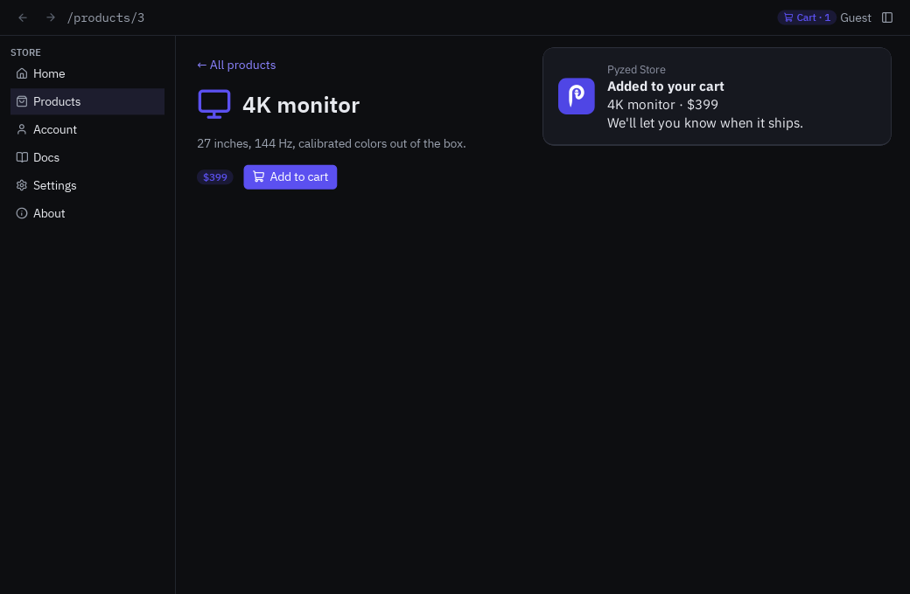

`pz.notify` shows the operating system's own notifications: toasts on Windows 10 and 11, the
Notification Center on macOS and the notification server on Linux (GNOME, KDE, Cinnamon, XFCE,
dunst, mako...).

```python
import pyzed as pz

pz.notify("Order shipped", "Your monitor is on its way", href="/orders/3")
```



Clicking it **brings the window to the front** and, with `href`, goes to that page.

## Buttons

```python
pz.notify("New message", "Ana: are we still on for today?",
          actions={"reply": "Reply", "/inbox": "Open inbox"},
          on_action=lambda action: print("pressed", action))
```

`actions` is `{id: label}` or a list of labels. A button whose id is an address (`/inbox`,
`?tab=unread`) opens that page by itself; the others call `on_action(id)`.

## Every option

| Option | What it does |
| --- | --- |
| `title`, `body` | the text |
| `icon`, `image` | a path or PNG bytes; `image` is a bigger picture where the system shows one |
| `actions` | the buttons |
| `href` | the page a click opens |
| `on_click(notification)`, `on_action(id)`, `on_close(reason)` | run **on the UI thread** |
| `urgency` | `"low"`, `"normal"` or `"critical"` (stays until answered) |
| `sound` | `True` (the system's), `False`, or a sound's name |
| `timeout` | seconds on screen; `0` until dismissed; `None` the system's default |
| `tag` | a new notification with the same tag replaces the old one |

`on_close` receives `"expired"`, `"dismissed"`, `"closed"` or `"unknown"`.

## The notification it returns

```python
progress = pz.notify("Downloading", "0 %", tag="download")
progress.update(body="60 %")
progress.close()
```

`notification.native` says whether the system's notifications showed it, `closed` whether it
left the screen and `reason` why.

## With actions and the router

The usual place is the `on_done` of an [action](/pyzed/routing/data/actions/), or the action
itself:

```python
@pz.action(refresh=False)
async def add_to_cart(product):
    await api.place_order([product.id])
    cart.add(product.id)
    pz.notify("Added to your cart", product.name, actions={"/cart": "See cart"})
```

## Each system

| System | How | Good to know |
| --- | --- | --- |
| Linux | `org.freedesktop.Notifications` over D-Bus | buttons, clicks and closing reasons depend on the server; `pz.notifications.capabilities()` lists them |
| Windows 10/11 | WinRT toasts | from a script they show as PowerShell's; a packaged app sets `pz.notifications.app_id` to its AppUserModelID |
| macOS | the Notification Center | from a script they show as the terminal's; a packaged app sets `app_id` to its bundle identifier. One button, or a menu of them |

`pz.notifications.app_name` is the name shown (the window's title by default) and
`pz.notifications.supported()` says whether native notifications work here. Where they don't (a
Linux session without a notification server, Android), `pz.notify` falls back to `notify-send`,
`osascript` or PowerShell: the text shows, without buttons or clicks.

## In Pyzed Design

The **Notification** component of the toolbox (System category) does the same without code: set
its title, text, buttons (one per line) and the page a click opens, then call `show()` from an
event. Its `clicked`, `action` and `closed` events follow what the user does.
