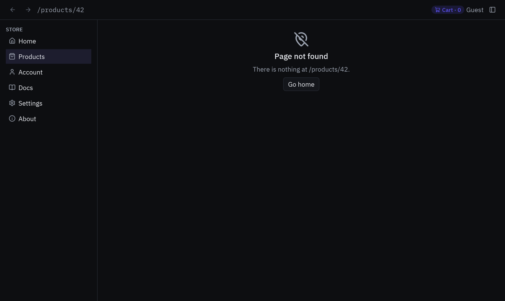

## error.py

`error.py` catches what fails below it: its pages, nested layouts, their `load` and the
middleware of those addresses. `reset` drops the failed data and tries again:

```python
# app/error.py
import pyzed as pz
from pyzed import ui


def error(error, reset):
    return pz.column([
        ui.heading("Something went wrong", level=2),
        ui.label(str(error), color="text_muted"),
        ui.button("Try again", reset, icon="rotate-ccw"),
    ], spacing=12)
```


The error shows **inside the layouts above it**, so the sidebar stays usable. An `error.py` does
not catch its own folder's layout: that one is caught one level up, as in Next.js. The
traceback is printed in the terminal too.

The function also receives `info`, a `pz.ErrorInfo` with the error's type, message and
traceback, for an error card with details:

```python
def error(error, reset, info):
    return ui.error_card(info, actions=[ui.button("Try again", reset)])
```

## not_found.py

`not_found.py` shows for addresses that match no page, and wherever a page, a `load` or a
middleware calls `pz.not_found()`. The closest one above wins:

```python
async def load(params):
    product = await api.product(params["id"])
    if product is None:
        pz.not_found()           # shows the closest not_found.py
    return product
```



## Redirects

`pz.redirect("/login")` goes to another page instead of the one being drawn, replacing the
history entry (`push=True` adds one instead). It works in pages, layouts and `load`; for checks
that run before any page, use [middleware](/pyzed/routing/advanced/middleware/).

```python
# app/settings/page.py: /settings shows its first tab
def page():
    pz.redirect("/settings/profile")
```

## Without these files

Pyzed shows its own error card (with the traceback in the terminal and a "Try again") and its
own "Page not found", in the app's language.
