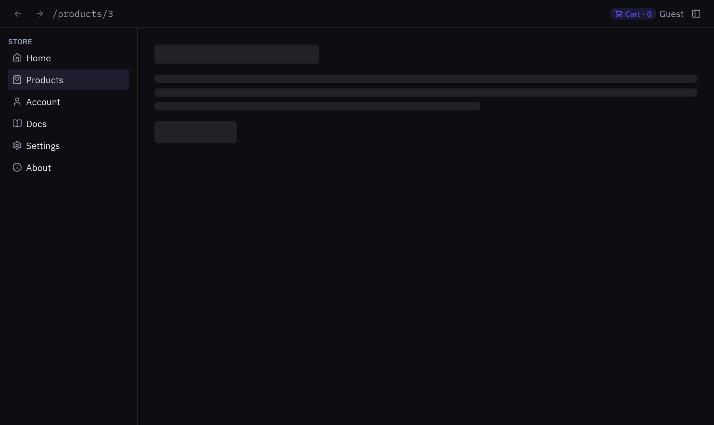
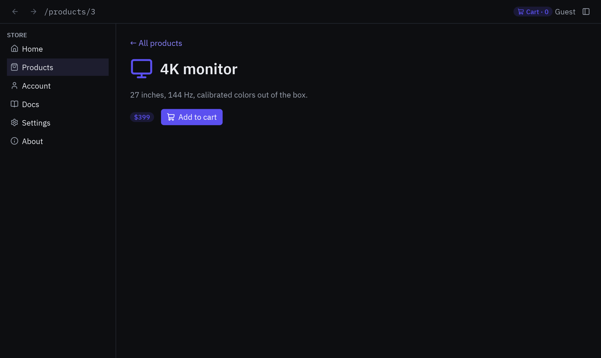

A page that needs data from a server or a database gets it with `load`, a function next to
the page. `load` runs **off the UI thread**, so the window keeps answering while the request
travels. What `load` returns reaches the page as `data`:

```python
# app/(shop)/products/[id]/page.py
import pyzed as pz
from pyzed import ui

import api                      # api.py next to app/


async def load(params):
    product = await api.product(params["id"])
    if product is None:
        pz.not_found()
    return product


def title(data):
    return data.name


def page(data):
    return pz.column([pz.link("/products", "← All products"), ui.heading(data.name)])
```


## async or not

| You write | It runs | Use it for |
| --- | --- | --- |
| `async def load(params)` | on Pyzed's asyncio loop, in the background | HTTP clients (`httpx.AsyncClient`, `aiohttp`), async database drivers |
| `def load(params)` | in a worker thread (4 of them) | `requests`, `sqlite3`, SQLAlchemy, reading files |

Both receive only the arguments they name: `params`, `query`, `locals` (from the
[middleware](/pyzed/routing/advanced/middleware/)) and `router`.

The page function itself can't be `async def`: widgets are built on the UI thread, so the awaits
go in `load`. The error message says so if you try.

### With httpx

```python
# api.py
import httpx

client = httpx.AsyncClient(base_url="https://api.example.com", timeout=10)


async def product(product_id):
    response = await client.get(f"/products/{product_id}")
    if response.status_code == 404:
        return None
    response.raise_for_status()           # other errors go to error.py
    return response.json()
```

### With a database

```python
# api.py
import sqlite3

def product(product_id):
    with sqlite3.connect("shop.db") as db:
        return db.execute("select * from products where id = ?", (product_id,)).fetchone()

# app/products/[id]/page.py: a plain def, so it runs in a worker thread
def load(params):
    return api.product(int(params["id"]))
```

### Several requests at once

`asyncio.gather` makes them in parallel, so the page waits for the slowest one and not for the
sum:

```python
import asyncio

async def load(params):
    product, reviews = await asyncio.gather(api.product(params["id"]), api.reviews(params["id"]))
    return {"product": product, "reviews": reviews}
```

## While it loads

The closest `loading.py` above the page takes its place while `load` runs, **inside the
layouts**, so the sidebar stays put:

```python
# app/(shop)/products/loading.py
import pyzed as pz
from pyzed import ui


def loading():
    return pz.column([ui.skeleton(height=28, width=240), ui.skeleton(height=16), ui.skeleton(height=16)],
                     spacing=12)
```





Without a `loading.py`, the previous page stays on screen until the new one is ready, like
Next.js does.

## The cache

A page's data is kept, so going back and forward shows it at once. It is kept by the page, its
`params` and its query: `/products?sort=price` and `/products?sort=name` are two entries.

| When | What happens |
| --- | --- |
| you come back within `stale_time` (30 s) | the kept data shows at once, no request |
| you come back later | `load` runs again; `loading.py` shows meanwhile |
| `router.refresh()` | the current page's `load` runs again, **the old data stays on screen** meanwhile |
| `router.invalidate("/products")` | that page's data is marked old: it loads again next time it shows |
| a [`pz.action`](/pyzed/routing/data/actions/) ends | the current page refreshes by itself |

`stale_time` is a router option: `pz.Router("app", stale_time=60)`, or
`pz.RouterApp("app", stale_time=60)`.

A layout can have its own `load` too: its data is kept while you move between the pages inside
it, and loads again only when its own `params` change.

## Loading before the click

A link starts its page's `load` when the mouse is over it, so the page is often ready by the
time it is clicked. `pz.link(..., prefetch=False)` turns it off, and `router.prefetch(href)` does
it from code (after a search, say, for the first result).

## When it fails

An exception in `load` goes to the closest [`error.py`](/pyzed/routing/basics/errors/), whose
"Try again" runs `load` again. `pz.not_found()` and `pz.redirect()` work inside `load` too.

## In tests

`router.wait()` waits for the pending loads, so a test can check the page with its data:

```python
router = pz.Router("app", initial="/products/3")
router.view()
router.wait()
assert router.title == "4K monitor · Shop"
```
