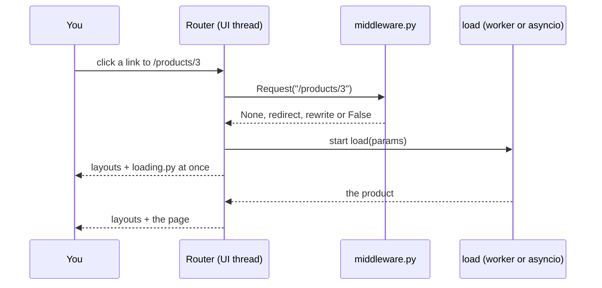

## From a click to the screen



1. **Middleware** runs, outer folders first. It can let the navigation through, send it
   elsewhere, show another route or stop it.
2. The address and the history change.
3. Each `load` on the way (layouts' and the page's) starts **in the background**. If the data is
   in the cache and fresh, nothing is requested.
4. The window draws at once: the layouts, and the closest `loading.py` where data is missing (or
   the previous page, if there is no `loading.py`).
5. When `load` answers, the window draws again with the page.

## The order of the files

In each folder, the files wrap each other like this, from outside to inside, and the next folder
goes in the middle:

```text
layout.py
└── template.py
    └── error.py            catches what fails inside
        └── loading.py      while the data inside is missing
            └── not_found.py
                └── the next folder… and finally page.py
```

That is why an `error.py` doesn't catch its own folder's layout (the layout is outside it), and
why a `loading.py` keeps the layouts of its folder on screen.

## Threads

| Runs on the UI thread | Runs off it |
| --- | --- |
| pages, layouts, templates and every `render()` | `load` |
| event handlers (`on_click`...) | `@pz.action` functions |
| `on_done`, `on_error`, notification clicks | `async def middleware` |
| sync `middleware` | |

The UI thread must stay free: building widgets is fast, but a request there freezes the window.
Anything that waits (the network, the disk, a database, `time.sleep`) goes in `load` or an
action.

## What draws again

Pyzed builds the view on every message (a click, a key, a finished `load`), but it **reuses the
last drawing of each component whose inputs did not change**, like `React.memo`. A component
draws again only when:

- its props or its own `pz.state` changed,
- a `pz.Store` field that its `render()` read changed,
- a value it read with `pz.use_context` changed,
- the theme, the language or the window size changed.

So adding to the cart redraws the badge that shows `cart.count`, and not the product list. Pages
and layouts written as functions run again on each drawing; that is fine, they only build
widgets. Put a slow piece behind a component so it can be reused.

## Where state lives

Each layout, template and page keeps its components' state in its own place:

- a **layout** keeps it while you stay below its folder (and while its `params` don't change),
- a **template** starts over on every navigation,
- a **page** starts over when its `params` change, not when only its query does.

Components created in a loop keep their state by position; give them `key=` when the items move.

## Rules of thumb

- ✅ Read in `load`, change with `@pz.action`, share with `pz.Store`.
- ✅ Keep filters and tabs in the query, so the history and links keep them.
- ✅ Return quickly from pages: they are called often.
- ❌ No `requests.get`, `time.sleep` or database calls in a page, a layout or `render()`.
- ❌ No `async def page`: put the awaits in `load`.
- ❌ Don't copy `data` into a store to "keep it": the router already caches it.
