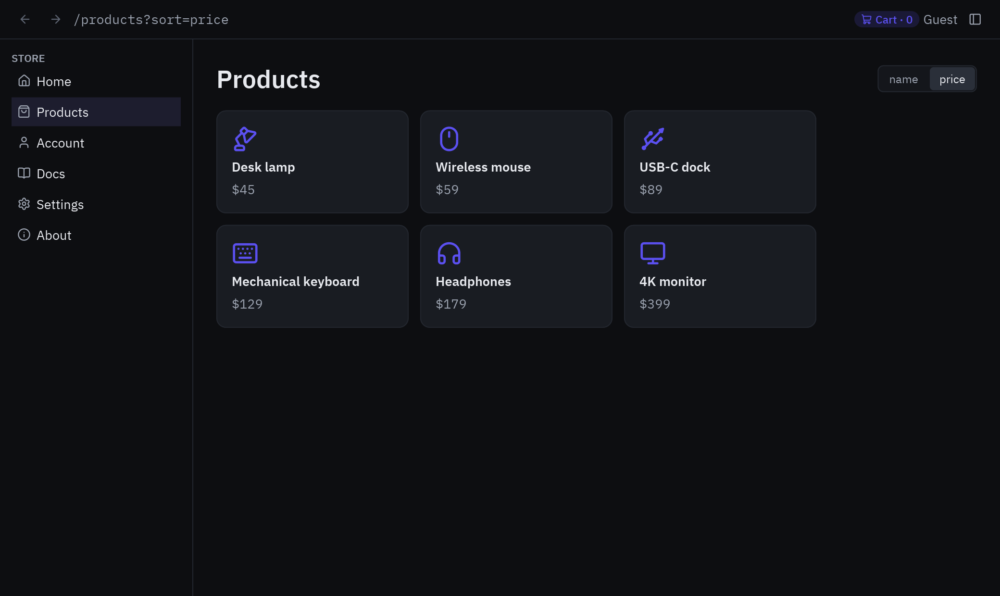

Every value on screen lives somewhere. Pick the place by **who needs it** and **how long it must
last**:

| Value | Where | Lasts |
| --- | --- | --- |
| a text being typed, an open menu | `pz.state` in the component | while the component is shown |
| a filter, a tab, a page number | the address (`?sort=price`) | in the history, and in links |
| what a page shows from the server | `load` → `data` | cached, refreshed after changes |
| the sidebar collapsed, a scroll | `pz.state` in a `layout.py` | while you stay below that layout |
| a team, a project shared by a subtree | `provide` + `pz.use_context` | while that layout is shown |
| the session, the cart, preferences | a `pz.Store` | the whole run (or between runs with `persist`) |
| a change being saved | `pz.action` (`pending`, `error`) | until the next call |

## Component state

```python
class Search(pz.Component):
    text = pz.state("")

    def render(self):
        return ui.input(self.text, on_input=lambda v: setattr(self, "text", v))
```

Changing `self.text` draws the component again. The state of a page component starts over when
its `params` change, and that of a layout stays while you navigate below it
([Pages, layouts and templates](/pyzed/routing/basics/pages-and-layouts/)).

## The address as state

What the user should be able to come back to belongs in the query: the back button returns to
it and a link or a notification can open the page there.

```python
def page(query, router):
    sort = query.get("sort", "name")
    return ui.segmented(["name", "price"], sort, lambda v: router.replace(f"?sort={v}"))


async def load(query):              # the query is part of the cache key
    return await api.products(sort=query.get("sort", "name"))
```



## Global state: `pz.Store`

A store holds what many pages share. Write a class with its fields, make **one instance** in a
module next to `app/`, and import it anywhere:

```python
# state.py
import pyzed as pz


class Cart(pz.Store):
    items: list = []                 # each instance gets its own copy of the default
    coupon: str = ""

    @property
    def count(self):                 # derived values are properties
        return len(self.items)

    def add(self, product_id):       # changes are methods
        self.items = [*self.items, product_id]


cart = Cart()
```

```python
# app/layout.py
from state import cart

def layout(children):
    return pz.column([header(badge=cart.count), *children])
```

**Only what read the store draws again.** Pyzed notes which stores each `render()` read, so
adding to the cart redraws the header's badge and leaves the rest of the window as it was. A
change made on another thread (a `load`, an action, a timer) redraws the window too.

| Call | Does |
| --- | --- |
| `cart.items = [...]` | sets a field; readers draw again |
| `cart.update(items=[], coupon="")` | sets several, one notification |
| `with cart.batch(): ...` | groups changes into one |
| `cart.changed()` | after changing a list or dict in place (`cart.items.append(x)`) |
| `cart.subscribe(callback)` | `callback(cart)` after each change; returns a function that stops it |
| `cart.reset()` | back to the defaults |
| `cart.to_dict()` | the values, as a dict |
| `def setup(self)` | runs once the values are set (open a connection, start a timer) |

### Keeping it between runs

```python
class Preferences(pz.Store):
    persist = "preferences"          # saved as JSON in the user's settings folder
    theme: str = "dark"
    recent: list = []
```

It is saved after every change and read back at the next start. Values JSON can't hold are
left out. `preferences.path` (on the instance) says where the file is.

### Replace, don't mutate

`self.items = [*self.items, x]` tells everyone at once. `self.items.append(x)` is seen by the
next drawing, but subscribers and `persist` only hear about it after `changed()`.

## Context for a part of the app

A layout's `provide` shares a value with everything below it, without a global:

```python
# app/teams/[team]/layout.py
async def load(params):
    return await api.team(params["team"])

def provide(data):
    return {"team": data}
```

```python
team = pz.use_context("team")       # in any component below
```

## What not to do

- Don't keep server data in a store "to cache it": `load` already caches, refreshes after an
  action and shows `loading.py`. A store is for the user's own values (the session, the cart).
- Don't put a filter in a store when it belongs in the address.
- Don't create a store inside `render()` or a page function: it would start over on every
  drawing. Create it once, in a module.
