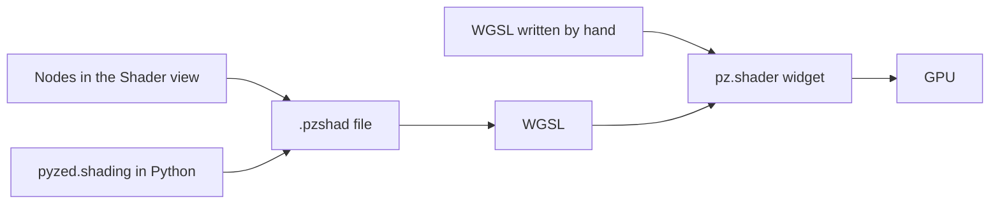

import { Aside } from '@astrojs/starlight/components';
import NavCards from '../../../components/NavCards.astro';

A **shader** is a tiny program that decides the color of every pixel of a widget, many times per second, on the
graphics card. It is how Pyzed draws animated backgrounds, glowing effects, radar screens and game visuals without
slowing your app down. If you have used Godot's visual shaders or Unreal Engine's material editor, Pyzed's shader
graphs will feel familiar.

## Three ways to make one

<NavCards
	items={[
		{ title: 'Shader graphs', text: 'Shaders made of nodes, saved as <code>.pzshad</code>. Draw them with <code>pz.shader</code> and change their variables from Python.', href: '/pyzed/shading/shader-graphs/', icon: 'puzzle', tag: 'Start here' },
		{ title: 'The Shader view', text: 'Wire nodes in Pyzed Design with live previews on every node, like Godot\'s visual shaders.', href: '/pyzed/shading/shader-designer/', icon: 'pencil', tag: 'Designer' },
		{ title: 'WGSL shaders', text: 'Write the <code>shade</code> function yourself for full control: uniforms, the mouse, time.', href: '/pyzed/shading/shaders/', icon: 'seti:shell', tag: 'Code' },
	]}
/>

<Aside type="caution" title="Shaders need a GPU">
On a machine without a usable graphics card, a shader widget draws its `fallback` color or gradient instead. Give
every shader a sensible fallback so your interface still reads well there.
</Aside>

## See them in action

<NavCards
	items={[
		{ title: 'Shader gallery', text: 'Plasma, a mouse ripple, a tunnel and more, each with its code.', href: '/pyzed/showcase/shaders/', icon: 'laptop' },
		{ title: 'The shader component', text: 'Options, sizes and examples of <code>pz.shader</code> in the component library.', href: '/pyzed/library/shader/', icon: 'puzzle' },
		{ title: 'pyzed.shading API', text: 'Every class and function to load, build and edit graphs in code.', href: '/pyzed/reference/shading/', icon: 'list-format' },
	]}
/>

## Coming next

<NavCards
	items={[
		{ title: 'Node catalog', text: 'Every node with a capture, its inputs and outputs, and what it is good for.', icon: 'list-format' },
		{ title: 'Shader recipes', text: 'Step-by-step effects: fire, water, scanlines, a glowing border, a loading spinner.', icon: 'star' },
	]}
/>

<Aside type="note" title="Status of this section">
Shader graphs are new in Pyzed. The pages above describe what works today; the node catalog and the recipes, with
animated previews, will be added in the next updates of this section.
</Aside>
