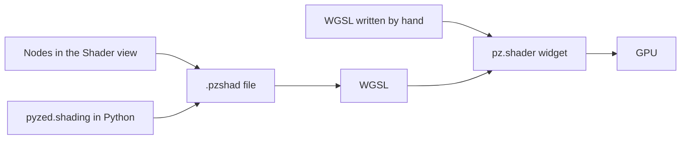

import { Aside } from '@astrojs/starlight/components';
import NavCards from '../../../components/NavCards.astro';

A **shader** is a tiny program that decides the color of every pixel of a widget, many times per second, on the
graphics card. It is how Pyzed draws animated backgrounds, glowing effects, radar screens and game visuals without
slowing your app down. If you have used Godot's visual shaders or Unreal Engine's material editor, Pyzed's shader
graphs will feel familiar.

## Start here

<NavCards
	items={[
		{ title: 'Your first shader', text: 'Build a glowing, pulsing circle with the mouse in ten minutes, then use it in an app. No math needed.', href: '/pyzed/shading/getting-started/', icon: 'rocket', tag: 'Start here' },
		{ title: 'The Shader view', text: 'The node editor of Pyzed Design: tabs, gestures, the sidebar, variables and properties.', href: '/pyzed/shading/shader-designer/', icon: 'pencil', tag: 'Designer' },
		{ title: 'Recipes', text: 'Gradients, a neon glow, plasma, clouds, cells, a CRT screen, a spotlight, a spinner, fire and stripes.', href: '/pyzed/shading/recipes/', icon: 'star', tag: '10 recipes' },
	]}
/>

## Every node

The [node catalog](/pyzed/shading/nodes/) describes all the nodes of a graph, by category, with their ports,
settings and an example each.

<NavCards
	min="13rem"
	items={[
		{ title: 'Inputs and constants', text: 'UV, pixel, size, time, mouse, variables and fixed values.', href: '/pyzed/shading/nodes/inputs/', icon: 'puzzle' },
		{ title: 'Math', text: 'Arithmetic, sin and friends, mix, clamp, smoothstep, remap.', href: '/pyzed/shading/nodes/math/', icon: 'puzzle' },
		{ title: 'Vectors and UV', text: 'Compose, distance, polar; tile, scroll, rotate, twirl, pixelate.', href: '/pyzed/shading/nodes/vectors-uv/', icon: 'puzzle' },
		{ title: 'Noise and patterns', text: 'Perlin, fractal, Voronoi; checker, stripes, grid, gradients, waves.', href: '/pyzed/shading/nodes/noise-patterns/', icon: 'puzzle' },
		{ title: 'Shapes', text: 'Circle, box, ring, polygon, star; union and subtract; fill, stroke, glow.', href: '/pyzed/shading/nodes/shapes/', icon: 'puzzle' },
		{ title: 'Color and effects', text: 'Gradient, palette, hue, blend modes, layers, vignette, scanlines, textures.', href: '/pyzed/shading/nodes/color-effects/', icon: 'puzzle' },
		{ title: 'Logic and utility', text: 'Compare, select, named values, your own WGSL, shader functions, Output.', href: '/pyzed/shading/nodes/logic-utility/', icon: 'puzzle' },
	]}
/>

## Three ways to make one

| Way | For | Page |
| --- | --- | --- |
| **Nodes in the Shader view** | Everyone: wire boxes with the mouse and see the result on every node. | [The Shader view](/pyzed/shading/shader-designer/) |
| **`pyzed.shading` in Python** | Generating or editing graphs from code, tests, tools. | [Shader graphs](/pyzed/shading/shader-graphs/) |
| **WGSL by hand** | Full control, porting shaders from elsewhere. | [WGSL shaders](/pyzed/shading/shaders/) |

All three end up as the same WGSL code on the GPU, so they are equally fast, and a `.pzshad` made with the mouse
can be changed from Python (and the other way round).

<Aside type="caution" title="Shaders need a GPU">
On a machine without a usable graphics card, a shader widget draws its `fallback` color or gradient instead. Give
every shader a sensible fallback so your interface still reads well there.
</Aside>

## See them in action

<NavCards
	items={[
		{ title: 'Shader gallery', text: 'Plasma, a mouse ripple, a tunnel and more, each with its code.', href: '/pyzed/showcase/shaders/', icon: 'laptop' },
		{ title: 'The shader component', text: 'Options, sizes and examples of <code>pz.shader</code> in the component library.', href: '/pyzed/library/shader/', icon: 'puzzle' },
		{ title: 'pyzed.shading API', text: 'Every class and function to load, build and edit graphs in code.', href: '/pyzed/reference/shading/', icon: 'list-format' },
	]}
/>

<Aside type="note" title="Status of this section">
Shader graphs are new in Pyzed. Every page here describes what works today, and the node catalog is generated from
the code, so it always matches your version. Captures of each node and short animated previews of the recipes are
being added.
</Aside>
