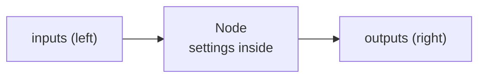

{/* Generated by docs/scripts/gen_shading_nodes.py from pyzed.shading and docs/scripts/shading_nodes_data.py. Do not edit. */}

import { Aside } from '@astrojs/starlight/components';
import NavCards from '../../../../components/NavCards.astro';

A shader graph is made of **92 node types** (and 137 entries in the Shader view's sidebar, since many
nodes come in several flavors: *Add*, *Multiply* and *Step* are all the **Math** node). This catalog describes each
one: what it is for in plain words, its ports and settings, and an example in Python.

<NavCards
	min="17rem"
	items={[
		{ title: "Inputs, parameters and constants", text: "The nodes every shader starts from: where the pixel is, the time, the mouse, your own variables and fixed values.", href: '/pyzed/shading/nodes/inputs/', icon: 'puzzle', tag: '15' },
		{ title: "Math", text: "Arithmetic, one-value functions (sin, fract, abs...), mix, clamp, smoothstep and remap: the glue of every shader graph.", href: '/pyzed/shading/nodes/math/', icon: 'puzzle', tag: '7' },
		{ title: "Vectors and UV", text: "Build and split vectors, measure distances and angles, and move, tile, rotate, twist or bend the coordinates.", href: '/pyzed/shading/nodes/vectors-uv/', icon: 'puzzle', tag: '19' },
		{ title: "Noise and patterns", text: "Organic randomness (Perlin, simplex, fractal, Voronoi) and regular patterns (checker, stripes, grid, dots, gradients, waves).", href: '/pyzed/shading/nodes/noise-patterns/', icon: 'puzzle', tag: '12' },
		{ title: "Shapes", text: "Circles, boxes, rings, lines, polygons and stars as signed distances, combined and drawn with fill, stroke and glow.", href: '/pyzed/shading/nodes/shapes/', icon: 'puzzle', tag: '10' },
		{ title: "Color, effects and textures", text: "Gradients, palettes, hue, saturation, blend modes and layers, screen effects (vignette, scanlines, grain) and images.", href: '/pyzed/shading/nodes/color-effects/', icon: 'puzzle', tag: '19' },
		{ title: "Logic, variables and utility", text: "Comparisons and if/else, named values, reroutes, your own WGSL, other shaders as functions, comments and the Output node.", href: '/pyzed/shading/nodes/logic-utility/', icon: 'puzzle', tag: '10' },
	]}
/>

## How to read a node

- **Inputs** are on the left of a node and **outputs** on the right. A wire goes from an output to an input.
- An input that is not wired uses its **default**: a number, a vector, a color, or a *context* value such as
  *UV* (the pixel's position) or *Time*. You can type another value right on the node.
- **Settings** are not ports: an operation, a noise kind, a blend mode, the stops of a gradient. Change them in the
  Properties panel (or as keyword arguments in Python).

### Types

| Type | What it holds | Example |
| --- | --- | --- |
| `float` | One number | `0.5`, a brightness, a time |
| `int` | A whole number | `5` octaves |
| `bool` | True or false | is the mouse over the shader? |
| `vec2` | Two numbers | a position `(x, y)`, a size |
| `vec3` | Three numbers | a color `(r, g, b)` from 0 to 1 |
| `vec4` | Four numbers | a color with alpha `(r, g, b, a)` |
| `texture` | An image | a `texture` variable |
| `T` | Any of the number types | Math nodes: the widest type wired to them |

Values convert on the way: a `float` fills every component of a vector (`0.5` becomes `(0.5, 0.5, 0.5)`), and a
`vec3` becomes a color with alpha 1. A wire that can never work, such as a texture into a number, is refused.

<Aside type="tip" title="Numbers from 0 to 1">
In shaders, colors and most masks go from **0 to 1**, not 0 to 255: `(1, 0.5, 0)` is orange, `0` is black and `1`
is white. Many nodes return 0..1 so you can multiply them together, like stacking stencils.
</Aside>

## Every node

|  |  |
| --- | --- |
| **Input** | [UV](/pyzed/shading/nodes/inputs/#uv), [Pixel](/pyzed/shading/nodes/inputs/#pixel), [Size](/pyzed/shading/nodes/inputs/#size), [Time](/pyzed/shading/nodes/inputs/#time), [Mouse](/pyzed/shading/nodes/inputs/#mouse), [Centered UV](/pyzed/shading/nodes/inputs/#centered-uv) |
| **Parameters** | [Parameter](/pyzed/shading/nodes/inputs/#parameter) |
| **Constants** | [Float](/pyzed/shading/nodes/inputs/#float), [Int](/pyzed/shading/nodes/inputs/#int), [Bool](/pyzed/shading/nodes/inputs/#bool), [Vector2](/pyzed/shading/nodes/inputs/#vector2), [Vector3](/pyzed/shading/nodes/inputs/#vector3), [Vector4](/pyzed/shading/nodes/inputs/#vector4), [Color](/pyzed/shading/nodes/inputs/#color), [Math constants](/pyzed/shading/nodes/inputs/#math-constants) |
| **Math** | [Math](/pyzed/shading/nodes/math/#math-1), [Function](/pyzed/shading/nodes/math/#function), [Mix](/pyzed/shading/nodes/math/#mix), [Clamp](/pyzed/shading/nodes/math/#clamp), [Smoothstep](/pyzed/shading/nodes/math/#smoothstep), [Remap](/pyzed/shading/nodes/math/#remap), [Multiply add](/pyzed/shading/nodes/math/#multiply-add) |
| **Vector** | [Compose](/pyzed/shading/nodes/vectors-uv/#compose), [Decompose](/pyzed/shading/nodes/vectors-uv/#decompose), [Swizzle](/pyzed/shading/nodes/vectors-uv/#swizzle), [Dot](/pyzed/shading/nodes/vectors-uv/#dot), [Cross](/pyzed/shading/nodes/vectors-uv/#cross), [Length](/pyzed/shading/nodes/vectors-uv/#length), [Distance](/pyzed/shading/nodes/vectors-uv/#distance), [Normalize](/pyzed/shading/nodes/vectors-uv/#normalize), [Reflect](/pyzed/shading/nodes/vectors-uv/#reflect), [Polar](/pyzed/shading/nodes/vectors-uv/#polar) |
| **UV** | [Tiling and offset](/pyzed/shading/nodes/vectors-uv/#tiling-and-offset), [Scroll](/pyzed/shading/nodes/vectors-uv/#scroll), [Rotate](/pyzed/shading/nodes/vectors-uv/#rotate), [Twirl](/pyzed/shading/nodes/vectors-uv/#twirl), [Pixelate](/pyzed/shading/nodes/vectors-uv/#pixelate), [Barrel](/pyzed/shading/nodes/vectors-uv/#barrel), [Kaleidoscope](/pyzed/shading/nodes/vectors-uv/#kaleidoscope), [Flip](/pyzed/shading/nodes/vectors-uv/#flip), [Repeat](/pyzed/shading/nodes/vectors-uv/#repeat) |
| **Noise** | [Noise](/pyzed/shading/nodes/noise-patterns/#noise-1), [Fractal noise](/pyzed/shading/nodes/noise-patterns/#fractal-noise), [Voronoi](/pyzed/shading/nodes/noise-patterns/#voronoi), [White noise](/pyzed/shading/nodes/noise-patterns/#white-noise), [Random](/pyzed/shading/nodes/noise-patterns/#random) |
| **Patterns** | [Checker](/pyzed/shading/nodes/noise-patterns/#checker), [Stripes](/pyzed/shading/nodes/noise-patterns/#stripes), [Grid](/pyzed/shading/nodes/noise-patterns/#grid), [Dots](/pyzed/shading/nodes/noise-patterns/#dots), [Linear gradient](/pyzed/shading/nodes/noise-patterns/#linear-gradient), [Radial gradient](/pyzed/shading/nodes/noise-patterns/#radial-gradient), [Wave](/pyzed/shading/nodes/noise-patterns/#wave) |
| **Shapes** | [Circle](/pyzed/shading/nodes/shapes/#circle), [Box](/pyzed/shading/nodes/shapes/#box), [Ring](/pyzed/shading/nodes/shapes/#ring), [Segment](/pyzed/shading/nodes/shapes/#segment), [Polygon](/pyzed/shading/nodes/shapes/#polygon), [Star](/pyzed/shading/nodes/shapes/#star), [Combine shapes](/pyzed/shading/nodes/shapes/#combine-shapes), [Fill](/pyzed/shading/nodes/shapes/#fill), [Stroke](/pyzed/shading/nodes/shapes/#stroke), [Glow](/pyzed/shading/nodes/shapes/#glow) |
| **Color** | [HSV to RGB](/pyzed/shading/nodes/color-effects/#hsv-to-rgb), [RGB to HSV](/pyzed/shading/nodes/color-effects/#rgb-to-hsv), [Hue shift](/pyzed/shading/nodes/color-effects/#hue-shift), [Saturation](/pyzed/shading/nodes/color-effects/#saturation), [Brightness and contrast](/pyzed/shading/nodes/color-effects/#brightness-and-contrast), [Luminance](/pyzed/shading/nodes/color-effects/#luminance), [Grayscale](/pyzed/shading/nodes/color-effects/#grayscale), [Invert](/pyzed/shading/nodes/color-effects/#invert), [Gamma](/pyzed/shading/nodes/color-effects/#gamma), [Posterize](/pyzed/shading/nodes/color-effects/#posterize), [Blend](/pyzed/shading/nodes/color-effects/#blend), [Palette](/pyzed/shading/nodes/color-effects/#palette), [Gradient](/pyzed/shading/nodes/color-effects/#gradient), [RGBA](/pyzed/shading/nodes/color-effects/#rgba), [Layer](/pyzed/shading/nodes/color-effects/#layer) |
| **Effects** | [Vignette](/pyzed/shading/nodes/color-effects/#vignette), [Scanlines](/pyzed/shading/nodes/color-effects/#scanlines), [Film grain](/pyzed/shading/nodes/color-effects/#film-grain) |
| **Texture** | [Sample texture](/pyzed/shading/nodes/color-effects/#sample-texture) |
| **Logic** | [Compare](/pyzed/shading/nodes/logic-utility/#compare), [Select](/pyzed/shading/nodes/logic-utility/#select), [Logic](/pyzed/shading/nodes/logic-utility/#logic-1) |
| **Variables** | [Set value](/pyzed/shading/nodes/logic-utility/#set-value), [Get value](/pyzed/shading/nodes/logic-utility/#get-value) |
| **Utility** | [Reroute](/pyzed/shading/nodes/logic-utility/#reroute), [Expression](/pyzed/shading/nodes/logic-utility/#expression), [Shader function](/pyzed/shading/nodes/logic-utility/#shader-function), [Comment](/pyzed/shading/nodes/logic-utility/#comment) |
| **Output** | [Output](/pyzed/shading/nodes/logic-utility/#output-1) |

<Aside type="tip" title="Try a node">
Each node is shown as it looks in the Shader view, with the preview of its default settings. To play with one, add
it from the Shading sidebar and wire it to the Output, or paste its example into a Python file and run it.
</Aside>
