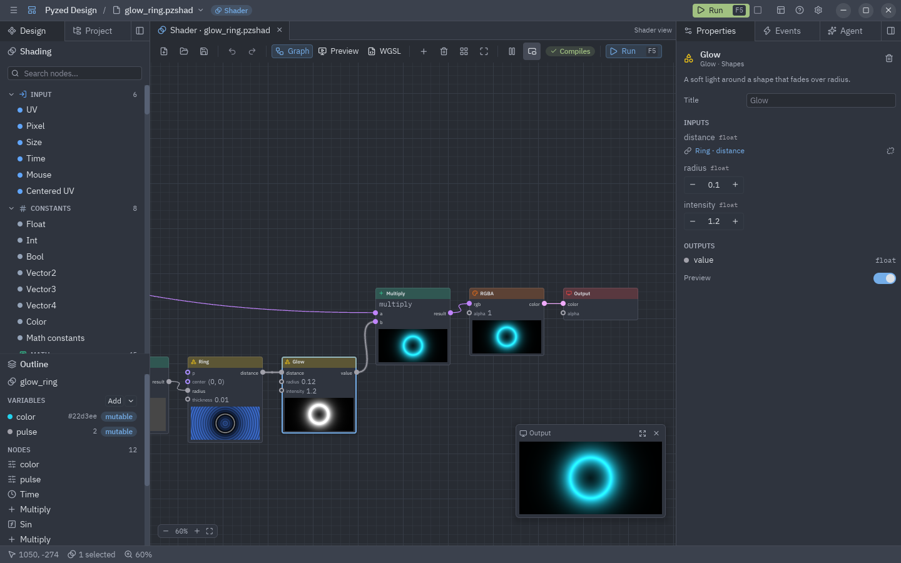
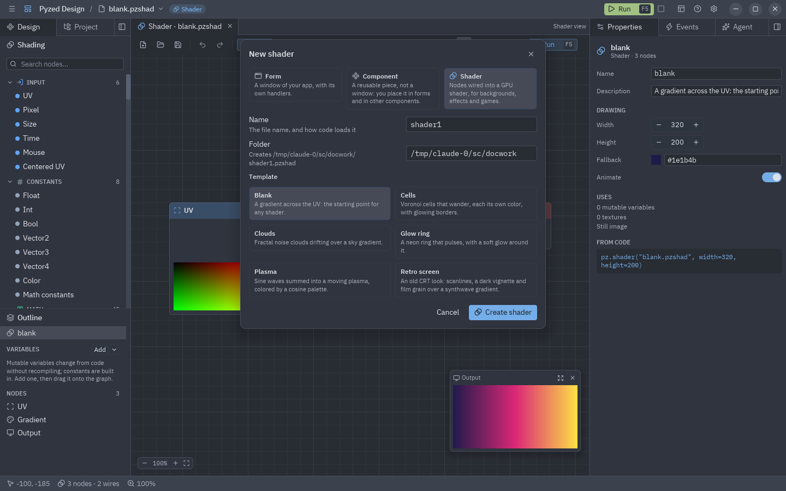
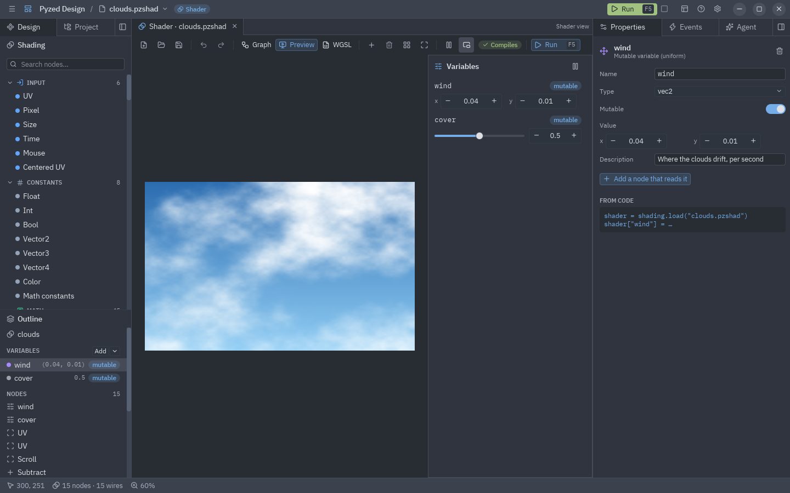

:::tip[New to shaders?]
Start with [Your first shader](/pyzed/shading/getting-started/): a ten-minute walk through this view that builds a
glowing circle step by step. This page is the full reference of the view.
:::

The designer has a third kind of document: **shaders**. Instead of writing WGSL, you wire nodes on a graph, as
in Godot's visual shaders or Blender's shader editor. Every node shows a live preview of what it makes, the
**Output** node is the finished shader, and the graph is saved as a `.pzshad` file that `pz.shader` draws on
the GPU.



There is no WGSL to write and no Rust: the designer compiles the graph to WGSL as you edit it, checks it with
the GPU compiler, and points at the node when something is wrong.

## Creating one

Press **New** (Ctrl+N) and pick the **Shader** card. Give it a name and a folder and pick a template: **Blank**
(a gradient), **Plasma**, **Clouds**, **Glow ring**, **Cells** or **Retro screen**. **Create shader** saves it
and opens it. You can also open a `.pzshad` file directly:



```bash
pyzed design effects/fire.pzshad     # created on first save if it does not exist
pyzed run effects/fire.pzshad        # the shader filling a window
```

## The Shader view

A shader opens in the **Shader view**, with three tabs in its toolbar:

| Tab | What it shows |
| --- | --- |
| **Graph** | The nodes on a canvas you pan and zoom. Each node has a preview of its first output; the small **Output** window in the corner shows the finished shader. |
| **Preview** | The finished shader, large, over a checkerboard (so transparency shows), with a slider for every variable. |
| **WGSL** | The code the graph compiles to, read only, with the compiler's messages on their lines. **Copy** puts it on the clipboard. |

The toolbar also has **Add a node** (Shift+A), **Delete**, **Arrange nodes in columns** (Ctrl+L), **Fit everything**
(F), **Stop time** (to freeze every preview at one moment), **Small preview** and **Run** (F5), which opens the
shader in a window of its own that follows your edits. A badge says **Compiles** or how many problems there are;
hover it to read them.

### Working on the canvas

| Gesture | What it does |
| --- | --- |
| Drag from an output to an input | Wires them. The wire takes the color of the value's type. |
| Drag a wire onto a node | Connects it to the first input (or output) that takes it. |
| Drop a wire on empty space | Opens the node search; the node you pick is added there, already wired. |
| Drag from a connected input | Picks the wire up again, to move it or drop it (disconnect). |
| Double-click or right-click the canvas | The node search, where the pointer is. |
| Drag a node | Moves it (and the rest of the selection). |
| Drag on empty space | Selects the nodes in the box. |
| Wheel | Zooms around the pointer. |
| Middle button, or Space + drag | Pans. |
| Right-click a node | Duplicate, copy, show or hide its preview, disconnect all, delete. |
| Double-click a node | Shows its settings; on a **Shader function** node, opens that `.pzshad`. |

The keyboard works as on forms: Ctrl+Z / Ctrl+Shift+Z, Delete, Ctrl+C / Ctrl+X / Ctrl+V (nodes travel between
shaders and windows), Ctrl+D, Ctrl+A, arrows to nudge, **P** to show or hide the selected nodes' previews,
Ctrl+0 for 100% and Ctrl+= / Ctrl+- to zoom.

### Inline values

An input that is not connected shows its value right on the node: a number field, a switch or a color swatch.
Inputs such as `uv`, `p` or `px` default to a **context** value (the pixel's UV, its centered position, its
pixel coordinates); the Properties panel switches them between that and a fixed value.

## The Shading sidebar

The left dock's **Design** panel has the **Shading** sidebar instead of the form toolbox. Its entries are grouped
by category; click one to add it in the middle of the graph, or drag it onto the graph. The search field
matches titles, categories and keywords in English and in the designer's language.

| Category | Nodes |
| --- | --- |
| **Input** | UV, Pixel, Size, Time, Mouse, Centered UV |
| **Parameters** | Parameter (reads a variable) |
| **Constants** | Float, Int, Bool, Vector2/3/4, Color, Math constants |
| **Math** | Add, Subtract, Multiply, Divide, Modulo, Power, Min, Max, Step, Atan2, Snap; Abs, Floor, Fract, Sqrt, Sin, Cos, Exp, Log and the other one-value functions; Mix, Clamp, Smoothstep, Remap, Multiply add |
| **Vector** | Compose, Decompose, Swizzle, Dot, Cross, Length, Distance, Normalize, Reflect, Polar |
| **UV** | Tiling and offset, Scroll, Rotate, Twirl, Pixelate, Barrel, Kaleidoscope, Flip, Repeat |
| **Noise** | Value, Perlin and Simplex noise, Fractal noise (fBm), Voronoi, White noise, Random |
| **Patterns** | Checker, Stripes, Grid, Dots, Linear and Radial gradients, Waves (sine, triangle, square, sawtooth) |
| **Shapes** | Circle, Box, Ring, Segment, Polygon, Star (signed distances), Union, Subtract and Intersect (smooth too), Fill, Stroke, Glow |
| **Color** | HSV ↔ RGB, Hue shift, Saturation, Brightness and contrast, Luminance, Grayscale, Invert, Gamma, Posterize, Blend (12 layer modes), Palette, Gradient (color ramp), RGBA, Layer |
| **Effects** | Vignette, Scanlines, Film grain |
| **Texture** | Sample texture |
| **Logic** | Compare, Select (if/else), And/Or/Xor/Not |
| **Variables** | Set value, Get value (named values inside the graph) |
| **Utility** | Reroute, Expression (your own WGSL), Shader function (another `.pzshad`), Comment |
| **Output** | Output: the color of every pixel (and its alpha) |

Every node, with its ports, settings and an example, is described in the [node catalog](/pyzed/shading/nodes/).

Ports are typed like Godot's: `float`, `int`, `bool`, `vec2`, `vec3`, `vec4` and `texture`. Most math nodes are
generic: they take the widest type wired to them (a `float` times a `vec3` is a `vec3`), and values convert on
the way (a `float` fills every component, a `vec3` becomes a color with alpha 1). A wire that can never work (a
texture into a number) is refused with a message.

## Variables in the outline

The **Outline** under the sidebar lists the shader's **variables**, its **named values** (from Set value nodes)
and every node. **Add** creates a variable; its arrow picks the type (`float`, `int`, `bool`, `vec2`, `vec3`,
`vec4`, `color` or `texture`). Drag a variable onto the graph to add a node that reads it.



| Kind | What it is | From code |
| --- | --- | --- |
| **Mutable** | A uniform: the GPU reads it every frame, so changing it costs nothing and needs no recompiling. | `shader["speed"] = 2` or `pz.shader("x.pzshad", uniforms={"speed": 2})` |
| **Constant** | Written into the generated code as a literal. Changing it builds the code again. | `shader.set(steps=8)` |

A variable has a value, a range (for the sliders) and a description. A `texture` variable is an image file; a
**Sample texture** node reads its color at a UV. Up to 32 mutable variables and 8 textures fit in one shader.

## Properties

The Properties panel shows what is selected:

- **A node**: its description, title, its settings (operation, noise kind, blend mode, gradient stops, the code
  of an Expression...), each input with its type (a link to the node wired into it, or its value) and its outputs.
  Problems found by the compiler show here and on the node, in red.
- **A variable**: name, type, mutable or constant, value, range and description, and the line of Python that
  changes it.
- **Nothing**: the shader itself: its name and description, the size of the Preview and Run windows, the
  **fallback** color drawn where there is no GPU, and whether it animates.

## Reusing shaders

A `.pzshad` is a file like a picture: use it anywhere.

- **In code**: `pz.shader("shaders/fire.pzshad", uniforms={"speed": 2})`, or load it with
  `pyzed.shading.load` and set its variables. See [Shader graphs](/pyzed/shading/shader-graphs/).
- **In forms**: the toolbox's **Shader** control (in Display) draws a `.pzshad`. Its **Shader file** property is
  the path, and **variables** (`{"speed": 2}`) sets its variables, from the Properties panel or from a handler.
- **In other shaders**: the **Shader function** node runs another `.pzshad` as a function. Its mutable variables
  become the node's inputs, and its `uv` input moves, tiles or warps it.
- **In games**: the [showcase](/pyzed/showcase/) backgrounds (nebula, synthwave, embers, color blobs, the radar)
  are `.pzshad` files in `examples/showcase/shaders`; open one to see how it is built.

A running app reloads a `.pzshad` when the file changes, so saving in the designer updates it.
