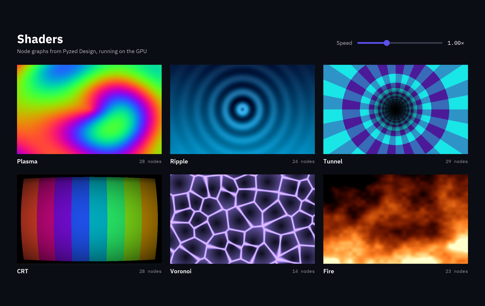

`pz.shader` is a widget painted on the GPU by a function you write in
[WGSL](https://www.w3.org/TR/WGSL/), the shading language of WebGPU. The GPU runs it for every
pixel, every frame, so animated backgrounds, plasma, fire or a radar sweep cost Python nothing.

:::tip[Prefer nodes?]
You can build shaders without writing WGSL: wire nodes in the designer's
[Shader view](/pyzed/shading/shader-designer/) and draw the `.pzshad` file with
`pz.shader("fire.pzshad")`. See [Shader graphs](/pyzed/shading/shader-graphs/).
:::



```python
WAVES = """
fn shade(uv: vec2<f32>, px: vec2<f32>, size: vec2<f32>, time: f32) -> vec4<f32> {
    let wave = 0.5 + 0.5 * sin(uv.x * 12.0 + time * speed());
    return vec4<f32>(mix(vec3<f32>(0.1, 0.1, 0.3), tint().rgb, wave), 1.0);
}
"""

pz.shader(WAVES, uniforms={"speed": 2.0, "tint": "accent"}, height=200)
```

## The `shade` function

Your code defines `shade`, plus any helper functions it needs. It gets:

| Argument | Meaning |
| --- | --- |
| `uv` | Where the pixel is, from `(0, 0)` at the top left to `(1, 1)` at the bottom right. |
| `px` | The same position in pixels. |
| `size` | The widget's size in pixels. |
| `time` | Seconds since the app started. |

It returns the pixel's color as `vec4<f32>(red, green, blue, alpha)`, each from 0 to 1, in the
same color space as CSS colors. `mouse()` returns the pointer position as a `uv` (negative when
the pointer is outside the widget); a shader that calls it redraws when the mouse moves.

## Uniforms

`uniforms` passes up to 32 values from Python. Each becomes a function with its name:

| Value | WGSL |
| --- | --- |
| A number | `speed()` returns `f32` |
| 2, 3 or 4 numbers | `vec2<f32>`, `vec3<f32>` or `vec4<f32>` |
| A color (hex or theme token) | `vec4<f32>` with the color's red, green, blue and alpha |

Change the values in `view()` like any other property: the shader is compiled once and only the
values change, so a slider can drive it at full frame rate.

## Options

- `width`, `height`: the size (`"fill"` by default).
- `animate=False` draws a still picture that only changes when the view does.
- `time=1.5` freezes `time` at that value.
- `fallback` is a color or gradient drawn where there is no GPU (and behind the shader where it is
  transparent).
- `textures={"photo": "assets/photo.png"}` passes up to 8 images: each becomes a function,
  `photo(uv)`, that returns the image's color at `uv` (it repeats outside 0..1).

## Errors

The code is checked when the widget is created, so a mistake raises a `ValueError` in Python
with the compiler's message and the line:

```text
ValueError: invalid shader:
error: no definition in scope for identifier: `colr`
   ┌─ wgsl:24:12
```

## Combining with other effects

A shader is a widget, so it works with the rest of Pyzed: put it in a `pz.stack` behind glass
panels (they blur it), clip it with a container, rotate or fade it with `style()` and
`animate()`. The [showcase](/pyzed/showcase/) demos use shaders for a space nebula, a synthwave
horizon, drifting embers and moving color blobs.

## Limits

- Shaders need the GPU renderer. On the software renderer (no GPU, and some CI machines) the
  widget shows `fallback`; screenshots taken there show it too. On Linux without a GPU,
  Mesa's software Vulkan driver (`mesa-vulkan-drivers`) runs them.
- The corners of a shader are square: `radius` on a container around it does not round them.
