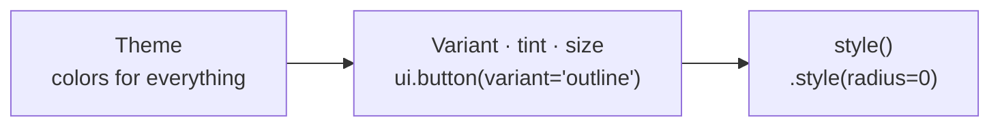

import { Aside } from '@astrojs/starlight/components';
import Media from '../../../components/Media.astro';
import variantsShot from '../../../assets/theming/button-variants-dark.png';

Before writing any style, check whether the component already has the look you want. Most components in
[`pyzed.ui`](/pyzed/library/) come in **variants**, **tints** and **sizes** that follow the theme. When none fits,
`style()` changes anything, like CSS.



Each step only overrides what it sets: the theme gives the colors, the variant picks which of them a component
uses, and `style()` has the last word.

## Variants

A **variant** is a ready-made look of the same component.

### Buttons

```python
ui.button("Save", save, variant="solid")       # filled with the accent: the main action
ui.button("Cancel", cancel)                    # "filled" (default): a neutral filled button
ui.button("Details", details, variant="outline")   # transparent with a border
ui.button("More", more, variant="ghost")       # no background until hovered
ui.button("Skip", skip, variant="subtle")      # like ghost, with muted text
ui.button("Archive", archive, variant="tinted")    # a translucent accent
```

| Variant | Background | Use it for |
| --- | --- | --- |
| `filled` (default) | `element` | Most buttons. |
| `solid` | the accent (or the tint) | The main action of a screen, one per area. |
| `tinted` | a translucent accent (or tint) | Secondary actions that should stand out a bit. |
| `outline` | none, with a `border` | Toolbars, secondary actions on busy surfaces. |
| `ghost` | none until hovered (`ghost_hover`) | Toolbars, menus, icon buttons. |
| `subtle` | like `ghost`, with `text_muted` | Low-priority actions. |

<Media src={variantsShot} alt="Buttons in each variant, tint and size, and badges in each variant" caption="Button variants, solid buttons in each tint, the four sizes and the badge variants (Pyzed Dark)." />

### Badges

```python
ui.badge("New")                               # "soft" (default): translucent background
ui.badge("Paid", tint="success", variant="solid")
ui.badge("Failed", tint="error", variant="outline")
```

`ui.icon_button` takes `variant` too (`"ghost"` by default), and many components have their own options, such as
`borderless=True` and `mono=True` on `ui.input`. Each component's page in the [Library](/pyzed/library/) shows its
variants.

## Tints

A **tint** recolors a component with one of the [status tokens](/pyzed/theming/tokens/#status): `"accent"`,
`"error"`, `"warning"`, `"success"`, `"info"` (and `"hint"` for callouts):

```python
ui.button("Delete", delete, variant="solid", tint="error")
ui.button("Delete", delete, variant="error")          # shortcut: a tinted error button
ui.callout("Saved", "Everything is up to date.", tint="success")
ui.progress(0.4, tint="warning")
ui.spinner(tint="info")
ui.count_badge(3, tint="error")
```

Since tints are tokens, they follow the theme: the same red button is a softer red in a light theme.

## Sizes

```python
ui.button("Tiny", on_press, size="xs")   # 18 px high
ui.button("Small", on_press, size="sm")  # 22 px
ui.button("Normal", on_press)            # "md": 28 px
ui.button("Large", on_press, size="lg")
ui.input(self.name, self.set_name, size="lg")
ui.select(options, self.choice, self.pick, size="sm")
```

## style() on any component

Every widget, including every `pyzed.ui` component, has a `style()` method with CSS-like properties
([the full list](/pyzed/theming/styles/#properties)). It is applied on top of the component's own look:

```python
ui.button("Square", on_press).style(radius=0, border=(2, "accent"))
ui.card(body, title="Usage").style(shadow=("#0006", (0, 8), 24), radius=16)
ui.label("Total").style(size=20, weight="bold", color="success")
```

`ui.button` also takes the low-level colors of the button directly (`bg`, `hover_bg`, `pressed_bg`, `color`), for
a fully custom button that still behaves like one:

```python
ui.button("Buy", buy, bg="#16a34a", hover_bg="#15803d", pressed_bg="#166534", color="#ffffff")
```

## Reuse a look: named styles

Give a style a name once and use it anywhere. Named styles are the "CSS classes" of Pyzed:

```python
pz.define_style("card", background="surface", border=(1, "border_variant"), radius=12, padding=16)
pz.define_style("danger", color="error", weight="semibold")

pz.column([...]).style("card")
ui.label("Payment failed").style("danger")
pz.column([...]).style("card", shadow=("#0005", (0, 4), 12))   # a name plus extra properties
```

A `pz.Style` object does the same without a global name, and styles combine with `|` (the right side wins):

```python
CARD = pz.Style(background="surface", radius=12, padding=16)
RAISED = CARD | pz.Style(shadow=("#0006", (0, 8), 24))
```

## A different theme for one component

Every `pyzed.ui` component takes `theme=`, to draw just that component with another theme, and a `with theme:`
block changes the theme of everything built inside it:

```python
ui.button("Light", on_press, theme=pz.themes.ONE_LIGHT)

with pz.themes.ONE_DARK.with_accent("#f97316"):
    warning_area = pz.column([ui.button("Go", go, variant="solid"), ui.progress(0.3)])
```

## Your own components

A [component](/pyzed/guides/components/) of your own should take its colors from the theme too, so it fits every
theme without changes. Use token names, or read the theme with `pz.theme.current()` in `render()`:

```python
class Tag(pz.Component):
    text: str = ""
    tint: str = "accent"

    def render(self):
        t = pz.theme.current()
        return pz.text(self.text, size=12).style(
            color=self.tint,
            background=pz.Paint(self.tint, opacity=0.15),
            radius=t.radius_sm,
            padding=(2, 8),
        )


Tag(text="beta", tint="warning")
Tag(text="new", style={"weight": "bold"})   # every component also accepts style=
```

Components made in the designer's component view follow the same rules; see
[Styling forms in the designer](/pyzed/theming/forms/).

<Aside type="tip" title="Which should I use?">
Variant or tint first; a named style when the same look repeats; `style()` for one-off changes; a custom theme when
the change is everywhere (for example, square corners in the whole app: `radius=0` in the theme, not on every
button).
</Aside>
