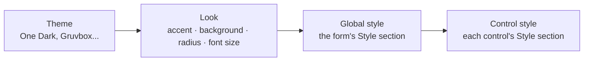

import { Aside, Steps } from '@astrojs/starlight/components';
import Media from '../../../components/Media.astro';
import shot_form_look from '../../../../screenshots/designer-light.png';

Forms made in [Pyzed Design](/pyzed/editor/) use the same themes and styles as code. You set them in the
**Properties** panel instead of writing Python, and they are saved in the `.pzform` file.

A form's look is built in layers, from broad to specific; each layer only changes what it sets:



## 1. The form's theme and look

Click an empty spot of the canvas to select the form, then open **Properties → Look**:

| Field | What it does | Saved as |
| --- | --- | --- |
| **Theme** | Any registered theme: the bundled ones and those your code registers. | `"theme": "Gruvbox Dark"` |
| **Accent** | A preset color, **×** for the theme's own, or **Custom accent** with any `#rrggbb`. Recolors primary buttons, focus, links and selection (`with_accent`). | `"accent": "#e11d48"` |
| **Background** | The window's background; empty keeps the theme's. | `"background": "#101418"` |
| **Corner radius** | The radius every control uses; `0` for square corners. | `"radius": 0` |
| **Font size** | The base size of every text. | `"font_size": 15` |

<Media src={shot_form_look} alt="A form in Pyzed Design with the Gruvbox Light theme and a custom accent" />

The form's theme is independent from the theme of the editor itself (Settings → Appearance): you can design a light
form in a dark editor.

## 2. The form's global style

With the form selected, its **Style** section is the window's global style (the same as `App.style` in code):

- **Text color, font, weight, italic, font size, line height** apply to every text that does not set its own. A
  serif font here changes every label, button and input of the form at once.
- **Background, border color, corner radius and padding** become the window's.

## 3. A control's style

Select a control and use its own **Style** section: background (a color, a gradient or a masked fill, with the
color picker), text color, font, weight, borders, corner radius, shadow, padding, margin and alignment. Empty fields
keep the component's own look, and **Reset style** clears them all. The
[Styles and themes](/pyzed/editor/styles-and-themes/) page of the designer describes every field and the color
picker.

Some controls also have **variant**, **tint** and **size** properties, the same as in code (see
[Styling components](/pyzed/theming/components/)): try a button's variant before styling it by hand.

<Aside type="tip" title="Keep colors that follow the theme">
The color picker works with concrete colors. To keep a color that changes with the theme, type a token
(`accent`, `text_muted`, `surface`...) in the field next to the swatch. The form then looks right if you switch it
to a light theme later.
</Aside>

## What the .pzform file stores

All of this is plain JSON in the form file, so it is easy to review in Git or to change by hand:

```json title="ui/main.pzform (excerpt)"
{
  "format": "pyzed.form/1",
  "form": {
    "name": "Main",
    "theme": "Gruvbox Dark",
    "accent": "#fe8019",
    "background": null,
    "radius": 4,
    "font_size": 14.0,
    "style": { "font": "serif", "color": "text" }
  },
  "controls": [
    {
      "name": "save",
      "type": "button",
      "props": { "text": "Save" },
      "style": { "radius": 0, "border_color": "accent", "border_width": 2 }
    }
  ]
}
```

`style` holds the same properties as [`style()`](/pyzed/theming/styles/#properties), written as
`Style.to_dict()` does (a gradient becomes `{"type": "linear", "angle": ..., "stops": [...]}`).

## Use your own theme in a form

The **Theme** list shows every registered theme. To use one of your own:

<Steps>

1. Register it in the form's code file (the `.py` next to the form, which Pyzed loads before the form runs):

   ```python title="ui/main.py"
   import pyzed as pz

   pz.themes.register(pz.Theme.generate("Acme", background="#16131f", text="#ece9f5", accent="#a78bfa"))


   def save_click(form, event):
       ...
   ```

2. Write its name in the form file (`"theme": "Acme"`), or pick it in **Properties → Look → Theme** once the
   designer lists it.

3. Run the form (**Run**, or `pyzed run`). It uses the Acme theme.

</Steps>

<Aside type="caution" title="Preview in the canvas">
A form whose theme name is not registered falls back to **One Dark**. If the canvas shows One Dark instead of your
theme, the module that registers it has not been loaded in the designer yet; the running app uses the right theme
once it imports that module.
</Aside>

## Change the look while the form runs

<Aside type="caution" title="Not supported yet">
A form's handlers can change its controls (`form.save.text = "Saved"`, `form.status.color = "error"`), but not its
theme: the theme is chosen when the form opens. For an app whose theme the user switches while it runs, write that
window in code with `pz.App` (see [Choosing a theme](/pyzed/theming/themes/#switch-themes-at-runtime)), or color
individual controls from handlers with theme tokens.
</Aside>
