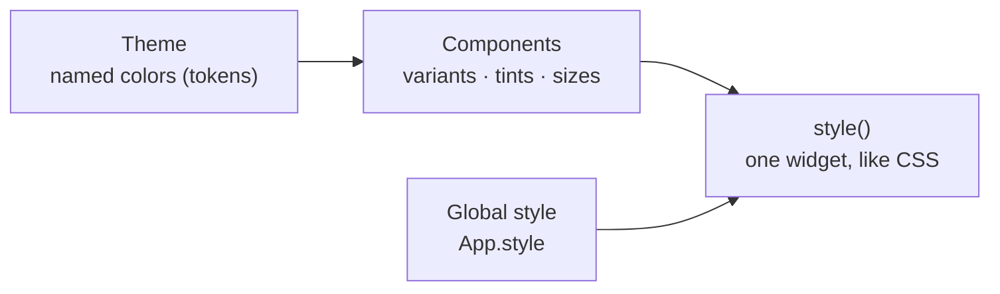

import { Aside, Tabs, TabItem } from '@astrojs/starlight/components';
import NavCards from '../../../components/NavCards.astro';
import Media from '../../../components/Media.astro';
import ayu from '../../../assets/editor/form-view-ayu.png';
import gruvbox from '../../../assets/editor/form-view-gruvbox.png';
import oneLight from '../../../assets/editor/form-view-light.png';

Pyzed separates **what** your interface shows from **how it looks**. Every component reads its colors from the
current **theme**, a set of named colors called tokens (`background`, `text`, `border`, `accent`...). Change the
theme and the whole app follows; change one widget with `style()` and only that widget changes.

<Media clip="themes" alt="The component gallery switching between One Dark, One Light, Ayu Mirage, Gruvbox Dark, Ayu Light and Gruvbox Light" caption="One app, six bundled themes: every component follows the theme, with no change to its code." eager />

```python
import pyzed as pz
from pyzed import ui


class Notes(pz.App):
    theme = "Gruvbox Dark"  # any name from pz.themes.names()

    def view(self):
        card = pz.Style(background="elevated", border=(1, "border"), radius=10, padding=16)
        return pz.column([
            ui.heading("Notes"),
            pz.container(ui.label("Styled like CSS, colored by the theme.")).style(card),
        ])
```

## How it fits together



- **Theme**: the palette of the whole app. Pick a bundled one, follow the system's light or dark mode, or create your
  own from three colors.
- **Components** take their colors from the theme. Their **variants** and **tints** (`variant="outline"`,
  `tint="error"`) choose which of those colors they use.
- **`style()`** changes one widget, like CSS; named styles reuse a look; `App.style` sets the font and colors of the
  whole window.

## Pyzed Design follows it too

The visual designer is a Pyzed app, so it has themes as well: pick one in **Settings → Appearance → Theme** and the
whole editor changes at once. Each form keeps its own theme, set in its **Look** properties (see
[Styling forms](/pyzed/theming/forms/)), so the editor and the app you design can look different.

<Media clip="designer-themes" alt="Pyzed Design changing its look as different themes are picked in Settings" caption="Pyzed Design switching themes from Settings." />

<Tabs>
	<TabItem label="Ayu">
		<Media src={ayu} alt="Pyzed Design in the Ayu theme with the sign-in form open" />
	</TabItem>
	<TabItem label="Gruvbox">
		<Media src={gruvbox} alt="Pyzed Design in the Gruvbox theme with the sign-in form open" />
	</TabItem>
	<TabItem label="One Light">
		<Media src={oneLight} alt="Pyzed Design in the One Light theme with the sign-in form open" />
	</TabItem>
</Tabs>

## In this section

<NavCards
	items={[
		{ title: 'Choosing a theme', text: 'The bundled themes, dark, light or following the system, and switching themes while the app runs.', href: '/pyzed/theming/themes/', icon: 'moon', tag: 'Start here' },
		{ title: 'Theme tokens', text: 'Every color of a theme and what it paints, with the values of One Dark and One Light.', href: '/pyzed/theming/tokens/', icon: 'list-format' },
		{ title: 'Creating themes', text: 'Change the accent, derive, generate from three colors, write a JSON theme file, import Zed themes.', href: '/pyzed/theming/custom-themes/', icon: 'pencil' },
		{ title: 'Styles', text: 'Backgrounds, borders, radius, shadows, gradients and effects for any widget, and the global style.', href: '/pyzed/theming/styles/', icon: 'seti:css' },
		{ title: 'Styling components', text: 'Variants, tints and sizes, <code>style()</code> on components, named styles and theme-aware components.', href: '/pyzed/theming/components/', icon: 'puzzle' },
		{ title: 'Styling forms', text: 'Theme, accent, radius and fonts of a form in Pyzed Design, and what the <code>.pzform</code> file stores.', href: '/pyzed/theming/forms/', icon: 'laptop', tag: 'Designer' },
		{ title: 'Icons and fonts', text: 'About 2000 bundled icons, file-type icons, and loading your own fonts.', href: '/pyzed/theming/icons-fonts/', icon: 'star' },
		{ title: 'Theme cookbook', text: 'Six complete themes to copy: brand, high contrast, retro terminal, glassy, pastel and mixed.', href: '/pyzed/theming/cookbook/', icon: 'rocket', tag: 'Examples' },
		{ title: 'Theme API', text: '<code>Theme</code>, <code>themes</code> and the color helpers, method by method.', href: '/pyzed/reference/theme/', icon: 'document' },
	]}
/>

<Aside type="tip" title="Use tokens, not hex colors">
Write `"accent"` or `"border"` instead of `"#3a7bc8"` where you can. Token colors change with the theme, so your
app keeps looking right in light and dark mode.
</Aside>

<Aside type="note" title="Status of this section">
Everything on these pages works today, in code and in Pyzed Design. Captures of every bundled theme in light and dark
are being added. Theming for mobile and web will come with those targets, which are planned but not available yet.
</Aside>
