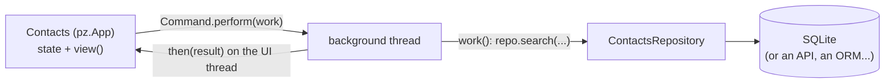

import { Aside, Code, Steps } from '@astrojs/starlight/components';
import Media from '../../../../components/Media.astro';
import NavCards from '../../../../components/NavCards.astro';
import Run from '../../showcase/_run.mdx';
import finished from '../../../../assets/tutorials/contacts-backend.png';
import source from '../../../../../../examples/tutorial/contacts_backend.py?raw';

Pyzed is the **frontend**: it draws windows and reacts to the user. Your data lives somewhere else: a database, a
REST API, files. This tutorial connects the two the way large apps do, with a thin **backend layer** the window
talks to, and every slow call moved off the UI thread so the window never freezes.

| Goal | Time | Level | You need |
| --- | --- | --- | --- |
| A contacts app backed by SQLite | 40 minutes | Advanced · Python | [Background tasks](/pyzed/tutorials/intermediate/background-tasks/) |

## What you'll learn

- Put all data access in a **repository** class with no UI in it, easy to test and to replace.
- Run queries in a **background thread** with `Command.perform(work, then)`.
- Show a **spinner** while a query runs, and turn exceptions into a message instead of a crash.
- Reload the view after a change (add, delete, search).

<Media src={finished} alt="The contacts app: a search box, a form to add a contact and a list of four contacts" caption="Every query runs in a thread; the window stays responsive even on a slow database." eager />

## The shape of the app



## Steps

<Steps>

1. **The repository.** Plain Python, no Pyzed import needed. It opens a connection per call, which makes it safe
   to use from any thread:

   ```python
   class ContactsRepository:
       def __init__(self, path=DEFAULT_DB):
           self.path = Path(path)
           with self.connect() as db:
               db.execute("CREATE TABLE IF NOT EXISTS contacts (id INTEGER PRIMARY KEY, name TEXT, email TEXT)")

       def connect(self):
           return sqlite3.connect(self.path)

       def search(self, text=""):
           with self.connect() as db:
               rows = db.execute("SELECT id, name, email FROM contacts WHERE name LIKE ? ORDER BY name",
                                 (f"%{text}%",)).fetchall()
           return [{"id": i, "name": n, "email": e} for i, n, e in rows]
   ```

2. **Never query on the UI thread.** A query that takes 300 ms would freeze the window for 300 ms.
   `Command.perform(work, then)` runs `work()` in a thread and calls `then(result)` back on the UI thread, where it
   is safe to change state:

   ```python
   def reload(self):
       return pz.Command.perform(lambda: self.repo.search(self.query), self.loaded)

   def loaded(self, contacts):
       self.contacts = contacts
   ```

3. **Busy and errors.** One small helper wraps every call: it sets `self.busy` (the view shows a spinner) and
   catches exceptions so they become a callout:

   ```python
   def background(self, work, then=None):
       self.busy, self.error = True, None

       def guarded():
           try:
               return ("ok", work())
           except Exception as exc:
               return ("error", str(exc))

       def done(outcome):
           self.busy = False
           kind, value = outcome
           if kind == "error":
               self.error = value
           elif then is not None:
               return then(value)

       return pz.Command.perform(guarded, done)
   ```

4. **Load on start, reload after changes.** `on_start` runs once when the window opens. Adding or deleting reloads
   the list when it is done:

   ```python
   def on_start(self):
       return self.reload()

   def add(self):
       name, email = self.name, self.email
       self.name = self.email = ""
       return self.background(lambda: self.repo.add(name, email), lambda _: self.reload())
   ```

5. **Test the backend alone.** Because the repository has no UI, a test is three lines:

   ```python
   repo = ContactsRepository(tmp_path / "contacts.db")
   repo.add("Grace Hopper", "grace@example.com")
   assert [c["name"] for c in repo.search("grace")] == ["Grace Hopper"]
   ```

</Steps>

<Aside type="tip" title="Async libraries">
If your client is async (`httpx.AsyncClient`, `aiosqlite`, SQLAlchemy's `AsyncSession`), pass an `async def` to
`Command.perform`, or return a coroutine from a callback: it runs on Pyzed's asyncio loop. See
[Async and subscriptions](/pyzed/guides/async/).
</Aside>

<Aside type="caution" title="Do not touch self from the thread">
`work()` runs in another thread: let it return a value and change `self` in `then`. Changing state from the worker
thread can race with drawing.
</Aside>

## Full code

<Code code={source} lang="python" title="examples/tutorial/contacts_backend.py" />

<Run file="examples/tutorial/contacts_backend.py" />

## Real backends

The same pattern with real libraries, each a complete project in
[`examples/integrations`](https://github.com/albakore/pyzed/tree/main/examples/integrations):

<NavCards
	items={[
		{ title: 'SQLAlchemy', text: 'Sessions in threads or an AsyncSession, and 20,000 rows in a virtual table.', href: '/pyzed/integrations/sqlalchemy/', icon: 'database' },
		{ title: 'FastAPI', text: 'A desktop client for an API: separate server, embedded or in-process.', href: '/pyzed/integrations/fastapi/', icon: 'server' },
		{ title: 'Django', text: 'The polls tutorial driven from a window through the ORM or over HTTP.', href: '/pyzed/integrations/django/', icon: 'puzzle' },
		{ title: 'httpx', text: 'Concurrent requests and streaming downloads with progress.', href: '/pyzed/integrations/httpx/', icon: 'external' },
	]}
/>

## Next

- [Package your app](/pyzed/tutorials/advanced/packaging/) for Windows, macOS and Linux.
- [Integrations overview](/pyzed/integrations/overview/): where your code runs and how forms show server errors.
