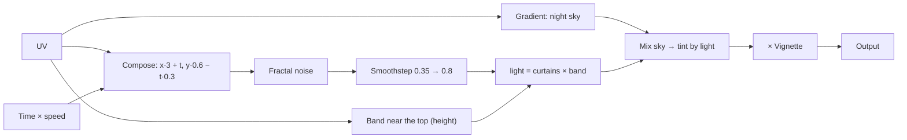

import { Aside, Code, Steps } from '@astrojs/starlight/components';
import Media from '../../../../components/Media.astro';
import Run from '../../showcase/_run.mdx';
import finished from '../../../../assets/tutorials/aurora.png';
import source from '../../../../../../examples/tutorial/aurora_graph.py?raw';

In [the intermediate shader tutorial](/pyzed/tutorials/intermediate/shader-effect/) you edited a template in the
Shader view. Here you build a shader from nothing, **in Python**, with the same graph the Shader view edits: an
aurora, curtains of green light drifting over a night sky, with sliders for its speed, height and color.

| Goal | Time | Level | You need |
| --- | --- | --- | --- |
| An animated aurora made of nodes, with live controls | 40 minutes | Advanced · Python | [A shader effect](/pyzed/tutorials/intermediate/shader-effect/) |

## What you'll learn

- Create a `shading.Graph`, add nodes by calling them, and pick their outputs.
- Use arithmetic on outputs (`+`, `-`, `*`) to add Math nodes for you.
- Combine **fractal noise**, **smoothstep** and a **gradient** into a picture.
- Add **mutable variables** (uniforms) and change them every frame from sliders.
- Save the graph as a `.pzshad` and keep editing it visually in Pyzed Design.

<Media src={finished} alt="A green aurora over a dark sky with a glass panel of sliders" caption="The aurora, with its controls in a glass panel." eager />

## How a shader thinks

A shader answers one question, for every pixel at once: *what color is this pixel right now?* It knows where the
pixel is (**UV**: from 0,0 at the top left to 1,1 at the bottom right) and the **time**. Everything else is math
on those two things. The graph is that math, drawn as boxes and wires:



## Steps

<Steps>

1. **A graph and its variables.** `g.uniform` adds a *mutable* variable (the GPU reads it every frame, so
   changing it is free) and returns a node that reads it:

   ```python
   from pyzed import shading

   g = shading.Graph("aurora")
   speed = g.uniform("speed", "float", 0.3, min=0, max=2)
   height = g.uniform("height", "float", 0.55, min=0.2, max=0.9)
   tint = g.uniform("tint", "color", "#34d399")
   ```

2. **Inputs.** Calling a node type on the graph adds that node. `node["name"]` picks an output, and arithmetic adds
   Math nodes:

   ```python
   uv = g.uv()
   t = g.time()["time"] * speed       # a Multiply node
   ```

3. **The curtains.** Stretch the coordinates sideways and move them with time, then sample **fractal noise**
   (layers of noise, each finer than the last; the classic look of clouds and smoke):

   ```python
   p = g.compose(uv["x"] * 3.0 + t, uv["y"] * 0.6 - t * 0.3)["vector"]
   curtains = g.fbm(p, scale=2.5, octaves=5)
   ```

4. **Keep them in a band.** `smoothstep(a, b, x)` is 0 below `a`, 1 above `b` and a smooth ramp between: the
   shader version of "fade in". Two of them make a band near the top, controlled by `height`:

   ```python
   band = g.smoothstep(height - 0.35, height, 1.0 - uv["y"]) * g.smoothstep(1.0, height, 1.0 - uv["y"])
   light = g.smoothstep(0.35, 0.8, curtains["value"]) * band
   ```

5. **Color it.** A **Gradient** node makes the sky; **Mix** blends from the sky to the tint where there is light;
   **Vignette** darkens the corners; **Output** is the final color:

   ```python
   sky = g.gradient(uv["y"], stops=[[0.0, "#020617"], [1.0, "#0f172a"]])
   glow = g.mix(sky["rgb"], tint * 1.4, light)
   g.output(g.rgba(glow * g.vignette(strength=0.6), 1.0)["color"])
   g.arrange()   # lay the nodes out in columns, like the Arrange button of the Shader view
   ```

6. **Show it.** `pz.shader` takes the graph, compiles it to WGSL once and runs it on the GPU. `uniforms=` sets the
   mutable variables by name, so the sliders change the picture without recompiling anything:

   ```python
   pz.shader(AURORA, uniforms={"speed": self.speed, "height": self.height, "tint": TINTS[self.tint]},
             width="fill", height="fill", fallback=pz.Gradient(["#020617", "#064e3b"], angle=180))
   ```

7. **Open it in the designer.** Run the example with `--save` to write `examples/tutorial/shaders/aurora.pzshad`,
   then `pyzed design examples/tutorial/shaders/aurora.pzshad`: every node you created in code is on the canvas,
   with its live preview, ready to tweak with the mouse.

</Steps>

<Aside type="tip" title="When you need raw WGSL">
An **Expression** node holds your own WGSL (`g.add("expression", code="sin(a * 10.0) * b", a=..., b=...)`), so
you never have to leave the graph for one special formula. For a whole shader in WGSL, see
[Shaders](/pyzed/shading/shaders/).
</Aside>

<Aside type="caution" title="Compile errors point at the node">
`g.compile()` returns the WGSL and the problems by node (`.errors`); a type mismatch (a texture into a number) is
refused with a `GraphError` the moment you wire it. In the Shader view the faulty node turns red.
</Aside>

## Full code

<Code code={source} lang="python" title="examples/tutorial/aurora_graph.py" />

<Run file="examples/tutorial/aurora_graph.py" />

## Next

- [Shader graphs](/pyzed/shading/shader-graphs/): the whole `pyzed.shading` API and the `.pzshad` format.
- The [Shading](/pyzed/shading/) section: every node, with examples.
- [Connecting a backend](/pyzed/tutorials/advanced/backend/).
