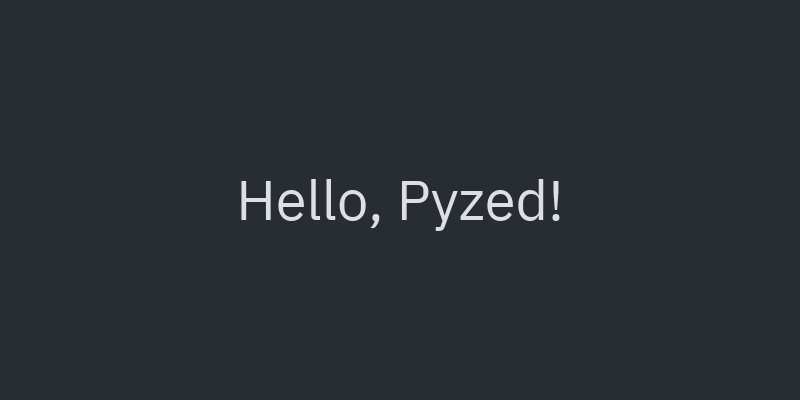
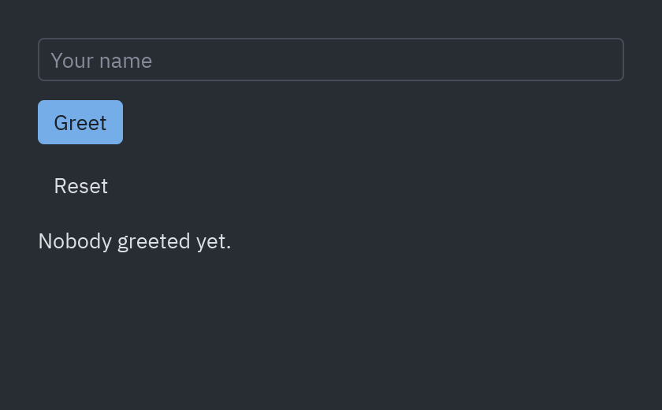
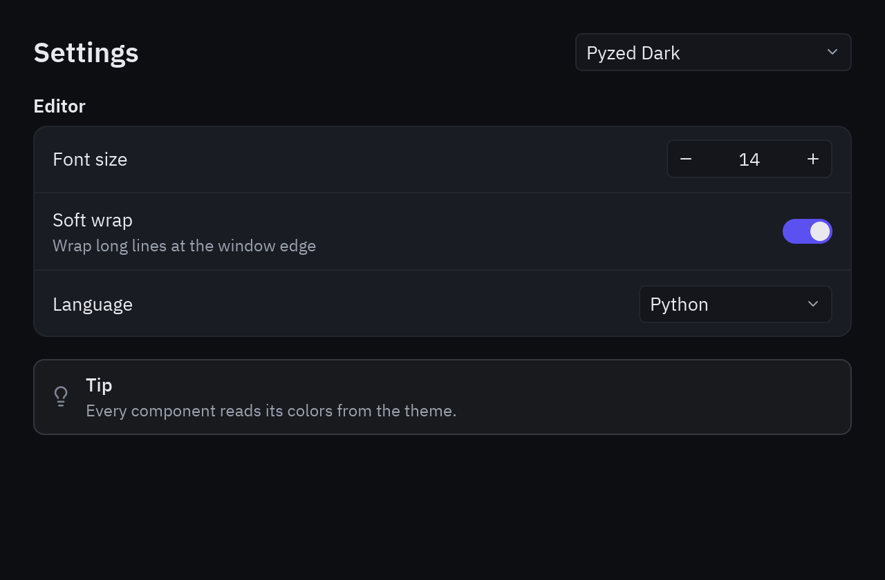
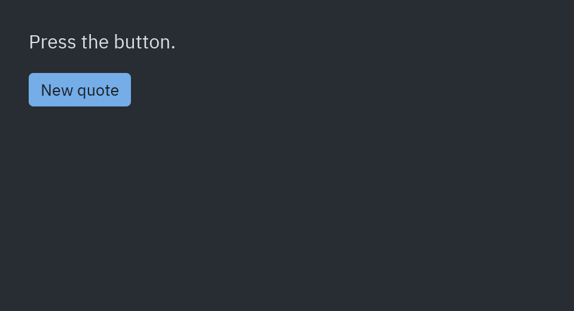
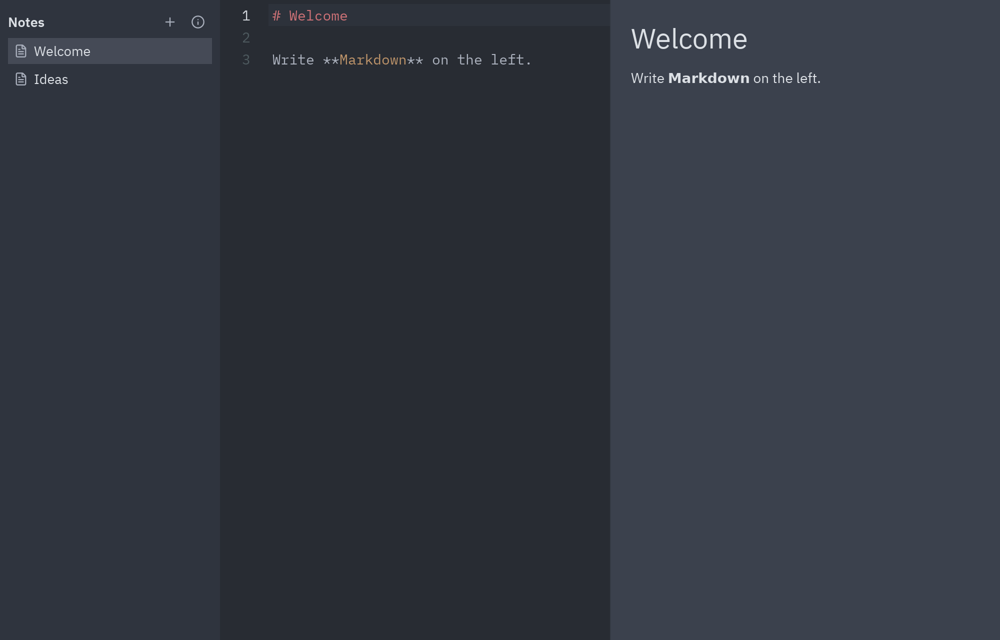

import { Aside, Code } from '@astrojs/starlight/components';
import Run from '../../showcase/_run.mdx';
import step1 from '../../../../../../examples/tutorial/step1_hello.py?raw';
import step2 from '../../../../../../examples/tutorial/step2_state.py?raw';
import step3 from '../../../../../../examples/tutorial/step3_layout.py?raw';
import step4 from '../../../../../../examples/tutorial/step4_async.py?raw';
import step5 from '../../../../../../examples/tutorial/step5_notes.py?raw';

Five short files in [`examples/tutorial/`](https://github.com/albakore/pyzed/tree/main/examples/tutorial).
Each one runs on its own and adds one idea to the previous one, so you can stop after any step and still have a
working program.

| Goal | Time | Level | You need |
| --- | --- | --- | --- |
| From an empty window to a notes app, in pure Python | 45 minutes | Basic · Python | Pyzed installed ([Installation](/pyzed/getting-started/installation/)) |

## What you'll learn

- How a Pyzed app works: an `App` class, its state and a `view()` that describes the window.
- Two ways to react to the user: messages sent to `update()` and plain callbacks.
- Layout, ready-made components and themes.
- Slow work with `async def` without freezing the window.
- Keyboard shortcuts, a resizable split and a second window.

<Run file="examples/tutorial/step1_hello.py" />

<Aside type="tip" title="Edit and see">
Run a step with `pyzed dev examples/tutorial/step1_hello.py` and the window updates every time you save the file,
without losing its state.
</Aside>

## 1. A window

An app is a class that inherits from `pz.App` and defines `view()`. `view()` returns a tree of
widgets (`pz.text`, `pz.column`, `pz.row`, `pz.container`…). Pyzed calls it again after every
change, so you never modify widgets: you describe what the current state looks like. Class
attributes such as `title` and `size` configure the window.

<Code code={step1} lang="python" title="examples/tutorial/step1_hello.py" />

## 2. State and messages

State is plain attributes on your object. Widgets are told what to do in two ways:

- **A value** (`ui.button("Greet", "greet")`): sent to `update(message)`.
- **A callable** (`ui.button("Reset", self.reset)`): called directly.

Callbacks that carry data receive the new value: `on_input=lambda text: ...`,
`on_toggle=lambda checked: ...`, `on_change=lambda value: ...`.

<Code code={step2} lang="python" title="examples/tutorial/step2_state.py" />

## 3. Layout, components and themes

`pyzed.ui` ships ready-made components (`button`, `input`, `select`, `number_field`,
`settings_group`, `callout`…) that take their colors from the active theme. `theme` can be a
`Theme`, the name of a bundled theme (`pz.themes.names()`) or `pz.themes.auto(...)` to follow
the system. `self.resolved_theme()` returns the `Theme` in use. More in [Theming](/pyzed/theming/themes/).

<Code code={step3} lang="python" title="examples/tutorial/step3_layout.py" />

## 4. Async

Slow work must not block the window. `Command.perform` accepts `async def` functions, which run
on Pyzed's asyncio loop; the result reaches your callback on the UI thread. While loading, a
`pz.every` subscription redraws the window to animate the spinner. You can also return
coroutines or generators from `update` and callbacks: see the
[Async and subscriptions](/pyzed/guides/async/) guide.

<Code code={step4} lang="python" title="examples/tutorial/step4_async.py" />

## 5. Putting it all together

A notes app: a sidebar list, an editor with a Markdown preview in a resizable `ui.split`, a
shortcut (`on_key` receives combos such as `"ctrl-n"`) and a second window (`pz.Window`) opened
with `return About().open()` that shares the app's state. More in
[Multiple windows](/pyzed/guides/windows/).

<Code code={step5} lang="python" title="examples/tutorial/step5_notes.py" />

## Next steps

- [To-do list](/pyzed/tutorials/basic/todo-app/) and the [mini code editor](/pyzed/tutorials/advanced/code-editor/), in more detail.
- [Data binding in the designer](/pyzed/tutorials/intermediate/data-binding/), if you prefer to draw your forms.
- [Examples](/pyzed/examples/): recreations of the Iced demos (game of life, clock, stopwatch,
  multi-window, images, QR codes, styling, pane grid…).
