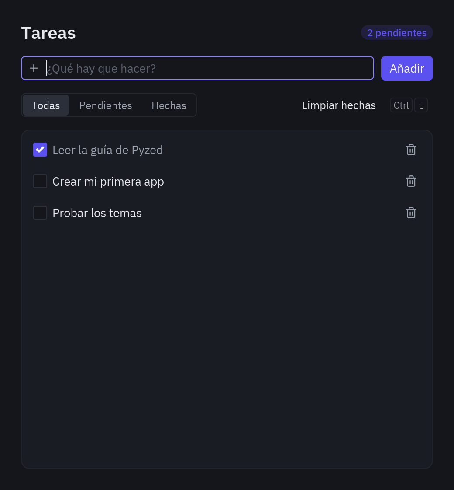

import { Code, Steps, Aside } from '@astrojs/starlight/components';
import source from '../../../../../../examples/todo.py?raw';
import Run from '../../showcase/_run.mdx';

In this tutorial we build a to-do list: the classic first app, and a good one, because it has everything a real
app has: data, a form to add to it, a list to show it and ways to change it.

| Goal | Time | Level | You need |
| --- | --- | --- | --- |
| A to-do list with filters and shortcuts | 30 minutes | Basic · Python | [5-step tutorial](/pyzed/tutorials/basic/step-by-step/) (steps 1 and 2) |

## What you'll learn

- Keep the app's data in plain Python objects (a dataclass).
- Read a text field as the user types, and submit it with <kbd>Enter</kbd>.
- Draw a list of rows with a checkbox and a delete button each.
- Filter what is shown, and add keyboard shortcuts.



<Steps>

1. **The model.** A task is a dataclass. The app state is the list of tasks, the text being
   typed and the active filter:

   ```python
   @dataclass
   class Task:
       title: str
       done: bool = False


   class Todo(pz.App):
       title = "Tasks"
       size = (520, 560)

       def __init__(self):
           self.tasks = [Task("Build my first app")]
           self.draft = ""
           self.filter = "All"
   ```

2. **Adding tasks.** The field is *controlled*: it shows `self.draft` and every keystroke
   updates it. Enter (`on_submit`) and the button call the same method:

   ```python
   def add(self):
       if self.draft.strip():
           self.tasks.append(Task(self.draft.strip()))
           self.draft = ""
       return Command.focus("new-task")      # give focus back to the field

   # in view():
   pz.row([
       ui.input(self.draft, lambda text: setattr(self, "draft", text), id="new-task",
                placeholder="What needs to be done?", on_submit=self.add, icon="plus"),
       ui.button("Add", self.add, variant="solid"),
   ], spacing=8)
   ```

3. **Drawing the list.** Each task is a `ui.list_item` with a checkbox at the start and a delete
   button at the end. The lambdas capture `task` because `task_row` receives the task as an
   argument:

   ```python
   def task_row(self, task):
       return ui.list_item(
           ui.label(task.title, color="text_muted" if task.done else "text"),
           lambda: self.toggle(task),
           start=ui.checkbox(task.done, lambda _: self.toggle(task)),
           end=ui.icon_button("trash-2", lambda: self.remove(task), size="sm", tooltip="Delete"),
           height=34,
           inset=True,
       )
   ```

4. **Filtering.** `ui.segmented` changes `self.filter`, and `view()` only shows the visible
   tasks. Since `view()` is called again after every change, there is nothing to "refresh":

   ```python
   ui.segmented(["All", "Pending", "Done"], self.filter, lambda f: setattr(self, "filter", f))
   ```

5. **Shortcuts.** `on_key` receives each key as text:

   ```python
   def on_key(self, combo):
       if combo == "ctrl-l":
           return self.clear_done()
       if combo == "ctrl-t":
           self.theme = "One Light" if self.resolved_theme().is_dark else "One Dark"
   ```

6. **Initial focus.** `on_start` runs once when the window opens:

   ```python
   def on_start(self):
       return Command.focus("new-task")
   ```

</Steps>

<Aside type="tip">
Try switching the theme with <kbd>Ctrl</kbd>+<kbd>T</kbd>: every component restyles itself
because it reads its colors from the active theme.
</Aside>

## Full code

<Code code={source} lang="py" title="examples/todo.py" />

<Run file="examples/todo.py" />

## Next

- [Data binding and validation](/pyzed/tutorials/intermediate/data-binding/) in the designer.
- [Lists and tables](/pyzed/tutorials/intermediate/lists-tables/): search, sort and select rows.
- The [Todos showcase](/pyzed/showcase/apps/#todos), which saves the list to disk.
