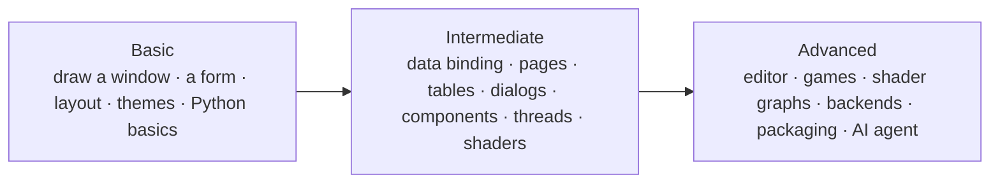

import { Aside } from '@astrojs/starlight/components';
import NavCards from '../../../components/NavCards.astro';
import Run from '../showcase/_run.mdx';

Every tutorial ends with a program you can run, and its full source is in the
[`examples`](https://github.com/albakore/pyzed/tree/main/examples) folder of the repository. Each one says what
you will build, how long it takes, what you need to know first and what you will learn.

<Aside type="tip" title="Never programmed before?">
Start with **Your first window in Pyzed Design**: you draw it with the mouse and run it with <kbd>F5</kbd>, no code
needed. Each tutorial after that adds a little Python, and explains every line.
</Aside>

## Basic

From an empty canvas to your first apps, with the designer and in code.

<NavCards
	items={[
		{ title: 'Your first window in Pyzed Design', text: 'Drag controls, set their properties, anchor them and run with F5. No code.', href: '/pyzed/tutorials/basic/first-window/', icon: 'pencil', tag: 'Start here' },
		{ title: 'A form that does something', text: 'A contact form: inputs, a Send button wired to Python, a live counter and the console.', href: '/pyzed/tutorials/basic/first-form/', icon: 'document' },
		{ title: 'Layout basics', text: 'Rows, columns, fill, spacing and grids, in code and with the designer\'s flex containers.', href: '/pyzed/tutorials/basic/layout-basics/', icon: 'list-format' },
		{ title: 'Change the theme', text: 'Bundled themes, accent colors, light/dark from the system and your own theme.', href: '/pyzed/tutorials/basic/themes/', icon: 'moon' },
		{ title: '5-step tutorial', text: 'From an empty window to a notes app with Markdown, async work and a second window, in pure Python.', href: '/pyzed/tutorials/basic/step-by-step/', icon: 'rocket' },
		{ title: 'To-do list', text: 'Your first complete app in code: state, a form, a list, filters and shortcuts.', href: '/pyzed/tutorials/basic/todo-app/', icon: 'approve-check' },
	]}
/>

## Intermediate

Real data, several screens and your own reusable pieces.

<NavCards
	items={[
		{ title: 'Data binding and validation', text: 'Bind controls to form.data and add rules in the designer; validate in one line.', href: '/pyzed/tutorials/intermediate/data-binding/', icon: 'approve-check-circle', tag: 'Designer' },
		{ title: 'A multi-view app', text: 'A sidebar that switches pages, tabs, breadcrumbs and shortcuts.', href: '/pyzed/tutorials/intermediate/navigation/', icon: 'bars' },
		{ title: 'Lists and tables with data', text: 'Search, sort, select a row and show its details.', href: '/pyzed/tutorials/intermediate/lists-tables/', icon: 'list-format' },
		{ title: 'Dialogs, notifications and validation', text: 'Field errors, a confirmation dialog and toasts that go away on their own.', href: '/pyzed/tutorials/intermediate/dialogs-feedback/', icon: 'comment-alt' },
		{ title: 'A custom component', text: 'Draw a reusable star rating with properties, bindings and a custom event.', href: '/pyzed/tutorials/intermediate/custom-component/', icon: 'puzzle', tag: 'Designer' },
		{ title: 'Background tasks', text: 'Downloads with progress, blocking work in a thread and notifications.', href: '/pyzed/tutorials/intermediate/background-tasks/', icon: 'random' },
		{ title: 'A shader effect from the Shader view', text: 'A glowing GPU background made of nodes, behind a form whose buttons change it.', href: '/pyzed/tutorials/intermediate/shader-effect/', icon: 'star', tag: 'GPU' },
	]}
/>

## Advanced

Whole applications, games and shipping them.

<NavCards
	items={[
		{ title: 'A mini code editor', text: 'A workspace with a file tree, tabs, syntax highlighting and a command palette.', href: '/pyzed/tutorials/advanced/code-editor/', icon: 'seti:python' },
		{ title: 'A game loop', text: 'Dodge: a frame loop, held keys, collisions, glow, particles and screen shake.', href: '/pyzed/tutorials/advanced/game-loop/', icon: 'laptop', tag: 'Game' },
		{ title: 'A custom shader graph', text: 'An aurora built node by node in Python, with sliders for its variables.', href: '/pyzed/tutorials/advanced/shader-graph/', icon: 'star', tag: 'GPU' },
		{ title: 'Connecting a backend', text: 'A repository class over SQLite, queries in threads, a spinner and friendly errors.', href: '/pyzed/tutorials/advanced/backend/', icon: 'database' },
		{ title: 'Package your app', text: 'A double-clickable app for Windows, macOS and Linux, and builds for all three from CI.', href: '/pyzed/tutorials/advanced/packaging/', icon: 'rocket' },
		{ title: 'Build an app with the AI agent', text: 'Describe an app, follow the agent\'s plan, review its changes and keep improving it.', href: '/pyzed/tutorials/advanced/ai-agent/', icon: 'comment-alt', tag: 'AI' },
	]}
/>

## Running the examples

Clone the repository (or download it as a zip) and run any example from its folder with the tool you use. `uv`
creates the environment for you; with `pip`, create and activate a virtual environment first. Every tutorial has
a block like this one with its own file:

<Run file="examples/todo.py" />

Forms made with the designer (`.pzform`) run with `pyzed run` instead of `python`:

<Run file="examples/tutorial/designer/hello.pzform" form />

<Aside type="note" title="About this section">
Tutorials are tested: every example app in `examples/tutorial` is imported, drawn off-screen and exercised by the
test suite, so the code on these pages runs with the current version of Pyzed. Short recordings of each tutorial
are being added.
</Aside>

<Aside type="tip">
New to Python? Read [Installation](/pyzed/getting-started/installation/) first, and the
[Quickstart](/pyzed/getting-started/quickstart/) to see a first window in five minutes. Looking for finished apps
to study? See the [Showcase](/pyzed/showcase/).
</Aside>
