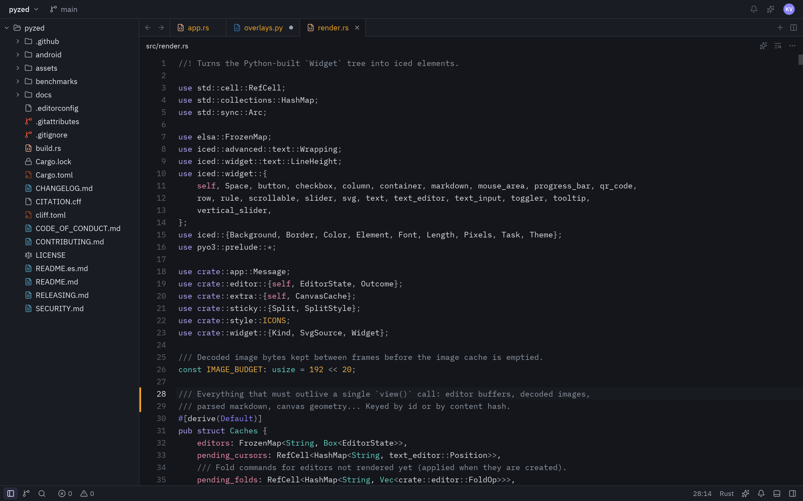
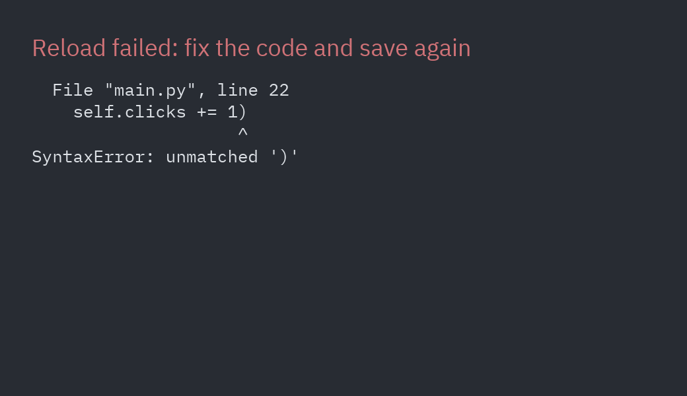

import { Card, CardGrid, LinkCard } from '@astrojs/starlight/components';
import Commands from '../../../components/Commands.astro';

Python is the first language of a whole generation of developers, but its desktop GUI story still feels
like 2005: grey widgets, layouts written by hand, restart-the-app-to-see-a-change, and a packaging step
that is a project of its own. **Pyzed** is our answer for people who grew up with VS Code, Figma, dark mode
and AI assistants, and expect their tools to look and feel like that.



## What you get on day one

<CardGrid>
	<Card title="A modern look, with no styling work" icon="seti:css">
		Dozens of components modelled on the [Zed](https://zed.dev) editor: buttons, inputs, tabs, trees,
		command palettes, menus, toasts, a code editor and dockable panels. Themes (One, Ayu, Gruvbox),
		dark mode and following the OS's appearance are built in.
	</Card>
	<Card title="Native speed, drawn by Rust" icon="rocket">
		Layout, text and drawing run in Rust through [Iced](https://iced.rs) and
		[wgpu](https://wgpu.rs) (Vulkan, Metal, DirectX 12 or OpenGL), with a CPU renderer as fallback.
		Python only describes the interface.
	</Card>
	<Card title="A Pythonic API" icon="seti:python">
		State lives in a normal class. `view()` returns what to show, and callbacks are plain methods
		or lambdas. No signals, no slots, no `.kv` files, no widget IDs to look up.
	</Card>
	<Card title="A visual designer" icon="pencil">
		[Pyzed Design](/pyzed/editor/) lets you draw forms, edit their code in a built-in editor with
		completion and diagnostics, and run them, all in one app.
	</Card>
	<Card title="Hot reload that keeps your state" icon="random">
		`pyzed dev main.py`: save a file and the running window changes, with your data still there.
	</Card>
	<Card title="Ready for AI assistants" icon="puzzle">
		An [MCP server](/pyzed/guides/mcp/) gives coding agents the exact API, the docs and screenshots
		of what they build, and [`pyzed.agents`](/pyzed/guides/agents/) puts models inside your app.
	</Card>
</CardGrid>

## The whole workflow, in a few commands

<Commands
	uv={`
		uvx --from pyzed-ui pyzed new shop
		cd shop
		uv run pyzed design     # draw the UI in Pyzed Design
		uv run pyzed run        # run it
		uv run pyzed build      # one standalone app for Windows, macOS or Linux
	`}
	pip={`
		pip install pyzed-ui uv
		pyzed new shop
		cd shop
		{activate}  # the project's own .venv
		pyzed design     # draw the UI in Pyzed Design
		pyzed run        # run it
		pyzed build      # one standalone app for Windows, macOS or Linux
	`}
	python={`
		{py} -m pip install pyzed-ui uv
		{py} -m pyzed new shop
		cd shop
		{vpy} -m pyzed design     # draw the UI in Pyzed Design
		{vpy} -m pyzed run        # run it
		{vpy} -m pyzed build      # one standalone app for Windows, macOS or Linux
	`}
/>

Projects are ordinary [uv](https://docs.astral.sh/uv/) projects, so dependencies, lock files, linting
([ruff](https://docs.astral.sh/ruff/)) and type checking ([ty](https://docs.astral.sh/ty/)) work the way the
rest of modern Python does. See [Create a project](/pyzed/getting-started/new-project/) and
[Build and distribute](/pyzed/packaging/build/).

## Code that reads like the UI

A counter, complete:

```python title="counter.py"
import pyzed as pz
from pyzed import ui


class Counter(pz.App):
    title = "Counter"

    def __init__(self):
        self.count = 0

    def view(self):
        return pz.center(pz.row([
            ui.button(icon="minus", on_press=lambda: setattr(self, "count", self.count - 1)),
            ui.heading(str(self.count)),
            ui.button(icon="plus", on_press=lambda: setattr(self, "count", self.count + 1)),
        ], spacing=12, align="center"))


pz.run(Counter)
```

There is no widget to find and update when the count changes: you change `self.count` and Pyzed calls
`view()` again. This is the [Elm architecture](https://guide.elm-lang.org/architecture/) that Iced uses,
and the same idea as React or SwiftUI, so it will feel familiar if you come from the web or mobile.


## Built for how people develop now

- **Edit, save, see.** Hot reload keeps the app's state, and when the new code fails, the error is shown in
  the window until you save a fix.

  

- **Your editor knows the API.** The package ships type information (`py.typed` and stubs for the Rust
  core), so completion and type checking work in VS Code, PyCharm, Zed and with ty or mypy.
- **Screenshots without a screen.** `app.screenshot("view.png")` renders off-screen, with no window or GPU,
  for tests, CI and documentation. Every image on this site was made that way.
- **Agents that do not guess.** Connect the [MCP server](/pyzed/guides/mcp/) to Claude Code, Cursor, VS Code
  or Zed and your assistant looks up real signatures, reads these docs and checks the code it writes. The
  docs are also published as plain text for language models in [`llms.txt`](https://albakore.github.io/pyzed/llms.txt).
- **Async when you need it.** Callbacks can be `async def` functions or generators; Pyzed runs them and
  sends their results back to `update`. See [Background tasks](/pyzed/guides/async/).

## Honest limits

Pyzed is young: its first release was in 2026, while tkinter, Qt and wxPython have decades behind them.
Today it targets **the desktop** (Windows, macOS and Linux): Android is an early prototype, and there are no iOS
or browser builds, which [Kivy](/pyzed/why/vs-kivy/) and [Flet](/pyzed/why/vs-flet/) offer. **Screen readers are not supported yet**
because Iced does not expose accessibility information ([details](/pyzed/guides/accessibility/#screen-readers)),
and its ecosystem of third-party widgets is small. The [comparison](/pyzed/why/comparison/) spells out where
other toolkits are the better choice.

## Compare

<CardGrid>
	<LinkCard title="Feature comparison" description="Pyzed next to tkinter, Qt, Kivy, Dear PyGui, Flet, Toga, NiceGUI, wxPython and CustomTkinter." href="/pyzed/why/comparison/" />
	<LinkCard title="Benchmarks" description="Startup, memory, update speed, install size and lines of code, measured and reproducible." href="/pyzed/why/benchmarks/" />
	<LinkCard title="Developer experience" description="From install to a packaged app: what the day-to-day feels like." href="/pyzed/why/developer-experience/" />
	<LinkCard title="Pyzed vs tkinter" description="The standard library toolkit, side by side." href="/pyzed/why/vs-tkinter/" />
	<LinkCard title="Pyzed vs PyQt / PySide" description="The most complete toolkit, and when its weight pays off." href="/pyzed/why/vs-pyqt-pyside/" />
	<LinkCard title="Pyzed vs Kivy" description="GPU-drawn widgets on desktop and mobile." href="/pyzed/why/vs-kivy/" />
	<LinkCard title="Pyzed vs Flet" description="Flutter from Python, for desktop, web and mobile." href="/pyzed/why/vs-flet/" />
	<LinkCard title="Pyzed vs Dear PyGui" description="Immediate-mode GUIs for tools and plots." href="/pyzed/why/vs-dear-pygui/" />
</CardGrid>

